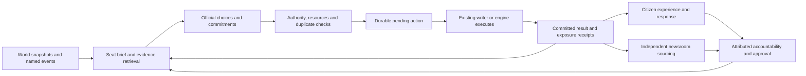

# Civic autonomy — decisions, city events, consequences and accountability

**Builder's words (2026-10-31):** "great document this as the research, and now lets build a plan that connects this to work better, crons get ample time or choices to do their work and a system that truely serves the sim, and provides citizens and the media to react to their choices and the civic officials being accountable. also when major events occur in the city they should be aware, the As havibg a parade downtown is a major event in that district, and the As winning is a moment for the cities mayor, i know there is only so much they can carry in context, the models they run also is importtant"

**Goal:** Officials independently choose grounded actions, events and programs; eligible choices change the world on a declared clock; exposed citizens and independent media can respond; the results and their attribution return to officials and approval without routine builder intervention.

**Rows:** No new rollout ID assigned; Claude registers a single coordinating pointer after accepting this plan. Existing `engine.260` organic civic-hire watch remains separate evidence. **Owner:** research-build coordinates Track A; engine-sheet owns Track B and engine landing.

This is a completed design proposal awaiting Claude review, not runtime authorization or a claim that its defaults are builder rulings. The request authorizes these documents. Model spend, production scheduling, Sheet changes, deployment and live proof retain their existing gates. Once implemented and activated under an approved policy, ordinary eligible decisions must not require another builder approval. Exceptions enter a visible technical/authority queue and never masquerade as successful civic work.

## Design decisions proposed for adoption

1. Officials choose from city evidence and their own priorities. A positive opportunity, a celebration, a quiet district and a real strain are all legitimate contexts. No default crisis story, housing premise, compulsory intervention, or authored list of eight initiatives.
2. Freeform initiative names and aims remain. A bounded set of executable simulation capabilities supplies effects, recipients, cost and duration. The official chooses an aim and a supported mechanism; the engine owns effect formulas and execution. Unsupported mechanics return a capability gap, never a cosmetic success.
3. Replies and public statements do not consume work capacity. Visits/listening only gain a material effect when an implemented receiver records one. Upkeep can cover an authorized portfolio in a bounded batch, with one receipt per initiative.
4. A mayor or district official receives a complete decision opportunity before the system calls a duty ignored. Missing data, prompt eviction, outage, an unimplemented lever and a deliberate refusal have different consequences.
5. Named major events retain their event identity, occurrence Cycle and geography across sports, city, citizen, civic and newsroom paths. Citywide significance and physical location are independent fields.
6. Officials control their own ballots and mayoral decisions on the new route. The engine validates eligibility, quorum and tally. Random outcomes may govern world effects; they do not silently replace a recorded official choice.
7. Approval responds to attributable delivery, conduct and observed response under the sim's rules. Speaking, issuing a proposal or taking credit for the A's win does not automatically earn approval. Positive, negative, mixed and indifferent reactions are possible.

## Relationship to existing work

Extend the current civic scheduler, move ledger, Initiative_Tracker, budget/upkeep/stage handlers and approval engine. Do not create a second scheduler, voter or publication pipeline. Existing Community_Programs, business/employment links, city-event carry, LifeHistory/Reflection paths, Ripple_Ledger and contract seeds are candidate receivers, mapped before changing them.

This plan proposes replacing the one-consequential-move rule, forced single-lever task, speech-as-work continuity, probability-based ballots for participating agents, and domain-only success promises. Older documents/personas that contradict current source or this accepted design get explicit supersession notes in Task A1; they are not silently treated as current. Historical proposed rows and existing programs are preserved until individually mapped. No retroactive approval or fictitious past events.

The research documents the current implementation. Tasks below specify changes. Numeric defaults here are recommended starting settings for evaluation, not measured safe rates or existing production configuration.

## The complete loop

An accepted request is pending. A committed result proves what happened. A measured result proves what changed. These must remain distinct in the brief, public record, media sources and completion accounting.

## Tasks

Task status lives only in this table. Task detail specifies scope and acceptance; it does not grant deployment authority.

| # | Task | Owner | Status |
|---|---|---|---|
| A1 | Reconcile civic facts, permissions and old contracts; freeze source/receipt baseline | research-build | not started |
| A2 | Build event-aware, model-budgeted seat briefs and bounded evidence retrieval | research-build | not started |
| A3 | Give each seat sufficient duty turns, independent replies, action batches and continuation receipts | research-build | not started |
| B1 | Implement action authority, durable execution journal, resource reservations and migration contract | engine-sheet, research-build | not started |
| B2 | Connect events, programs and project actions to real receivers; close typed gate defects | engine-sheet | not started |
| B3 | Make official ballots and mayor decisions binding through one vote authority | engine-sheet, research-build | not started |
| B4 | Connect committed outcomes to citizen exposure, diverse reactions and measured accountability | engine-sheet | not started |
| A4 | Give newsroom and next official wake source-linked choices, outcomes and responses | research-build | not started |
| A5 | Evaluate actual seat models, context/output limits and fallback behavior on frozen scenarios | research-build | not started |
| AB6 | Run composed sandbox proof, pilot mayor/D2, then extend to all districts | engine-sheet, research-build | not started |

### Implementation map

These are existing entry points to inspect and extend, not permission to edit protected paths. New helper/test names are chosen during the assigned task; every changed producer must name its persisted output and next reader.

| Tasks | Existing entry points |
|---|---|
| A1–A3 | `scripts/buildCivicOfficeSlice.js`, `scripts/cron-civic-run.js`, `scripts/civicProblemContinuity.js`, `scripts/civic-office-map.json`; Claude-owned civic personas and schedule configuration |
| A2/A4 event export | `scripts/dumpBeatTabs.js`, `scripts/buildCivicDomainSlice.js`, `scripts/buildCivicVoicePackets.js`; sports source `phase02-world-state/applySportsSeason.js` |
| B1 execution/persistence | `scripts/applyTrackerUpdates.js`, `scripts/cityHallLedger.js`, `phase09-digest/finalizeCycleState.js`, `phase10-persistence/persistenceExecutor.js` |
| B2 capability/delivery | `lib/initiativePhaseContract.js`, `phase05-citizens/civicInitiativeEngine.js`, `phase02-world-state/applyInitiativeImplementationEffects.js`, `phase04-events/buildCityEvents.js`; program receiver `phase05-citizens/runYouthEngine.js` |
| B3 ballots | `scripts/cron-civic-run.js`, `phase05-citizens/civicInitiativeEngine.js` |
| B4 experience/approval | `phase05-citizens/generateCitizensEvents.js`, `phase05-citizens/updateCivicApprovalRatings.js`, `lib/wakePerception.js`, `scripts/citizen-wake.js` |
| A4 media/feedback | `phase07-evening-media/buildContractSeeds.js`, `scripts/buildCivicDomainSlice.js`, `scripts/buildPulseSlice.js`, `scripts/buildCivicOfficeSlice.js` |
| A5 evaluation | `scripts/modelFitRun.js`, `scripts/modelFitScore.js`, `scripts/cron-civic-run.js` |

Execution timing is part of each capability's contract. State which writer applies it, its earliest eligible Cycle, phase ordering, and when later readers can observe the committed result. A new event can refresh awareness within the same Cycle without falsely claiming an action has already executed. Respect prior-Cycle stage/effect dependencies; no universal immediate-execution promise.

### A1 — Ground the officials in the current world

Files: `scripts/buildCivicOfficeSlice.js`, `scripts/civic-office-map.json`, `.claude/agents/civic-office-*/{IDENTITY,LENS,RULES}.md`, `docs/reference/CIVIC_GAME_LOOP.md`, applicable initiative plans. Claude edits control-plane/config files; guest lanes receive bounded script jobs only.

Keep personalities, ambitions, relationships and political differences where sourced. Move changing approval, turf, program state and availability out of static personas into authoritative typed brief fields. Resolve the Baylight/D2, Montclair and Fruitvale conflicts from the current Sheet export before rewriting facts. Remove unsupported crisis premises and distinguish an official's belief/claim from measured state. Retain sourced past commitments as history with a source and Cycle, not an evergreen instruction to repeat them.

Freeze C113 mayor/D2/D9 packs, serialized prompts, accepted/rejected moves, old parade source and relevant source hashes in a local-only evaluation fixture. Reconcile exact current program state independently before any migration. Acceptance: conflicting persona assertions cannot override fresh authority; a stable district has evidence for an open choice and may choose no action for a reason.

### A2 — Situation brief with citywide event awareness

Extend `buildCivicOfficeSlice.js` and its existing loaders. Produce one versioned brief with a snapshot generation/hash, not merely a Cycle filename. Separate these bounded sections: new city/district events; measured state and recent change; official's commitments and outcomes; opportunities/resources; citizen/media response; authorized actions. A given section's cap must not erase its selected action's required evidence.

Add a normalized event view over existing exported sports/world/city-event records. Proposed fields: stable `eventId`, `sourceRef`, `sourceRevision`, `occurredCycle`, `status` (announced/occurred/cancelled/corrected), `observedAt`, `category`, `significance`, canonical `hoods`, `citywideRelevance`, entity IDs and concise sourced facts. Source coordinates plus content revision preserve identity where no stable source ID exists; headline alone is not an identity. Merge two records for the same event through an alias record rather than replaying effects.

Route a verified championship result to the mayor by citywide significance, even if no neighborhood appears in its sentence. Route the recorded Downtown parade to D2 by typed location and to the mayor by significance. Route other affected districts only when the source actually supplies their geography. Never turn an unresolved place spelling into a new hood. A sports event can belong in civic and community awareness without changing athlete identity or making an athlete a civic desk patient.

Preserve occurrence versus discovery: C111 parade discovered in a C113 export is historical awareness, not a fresh event to execute. Late correction updates the record; cancellation prevents pending event execution. Same-Cycle new events must invalidate brief caches. Ingest/adapters supplying the snapshots must expose a refresh watermark; a scheduler reading a stale C113 dump cannot claim it saw everything that happened during C113.

Start with a compact overview and a finite evidence API: retrieve event by ID, district state, project detail, budget/authority, or prior result. Implement it in the runner for models without tool support as a structured read-request round. Only whitelisted local snapshot records; returned content remains data, never instructions. If required detail is unavailable, defer that dependent action while preserving independent choices.

Recommended initial budget: total serialized input target 8,000 tokens for a district and 12,000 for mayor, including persona, continuity and instructions; reserve output/reasoning separately using each actual provider profile. These are evaluation targets, not vendor context limits. Protect urgent unacknowledged events, pending deadlines and selected-action evidence first; paginate broad boards fairly rather than alphabetically truncating them. Include omitted counts, retrieval keys and freshness. Do not feed 600-character fragments with IDs whose legal instructions were dropped.

Acceptance: actual serialized prompts contain correct event age/location, enough evidence to choose/execute, and a quiet-district opportunity; mayor citywide news survives a large board; D2 sees the parade without a sports-only persona; a stale/missing snapshot never reads as no news.

### A3 — Enough opportunity to decide and follow through

Extend the existing `datawakeRota`, `runDatawake`, week state and hourly tick. Proposed service target: two completed regular duty opportunities per civic week for each of the ten elected seats, with least-served scheduling, plus event-triggered opportunities for affected seats. The chief keeps its distinct existing authority. Reserve event capacity; a major event does not replace both ordinary work opportunities. Initial extra-event ceiling: two extra turns per elected seat per civic week, coalescing related updates into one event brief. More due work remains visible in a queue, not silently dropped.

Routine work keeps the current civic-week window. Major events arising on citizen-life days can enter the ordinary citizen wake as awareness; urgent official decisions use a bounded explicit event-duty exception proposed for rollout. Do not convert every personal wake into office work. Event delivery target: next available civic/event slot after a fresh event export, with its due clock and reason recorded. Paid execution concurrency and weekly spend ceilings are independent of eligibility.

Proposed output contract separates `statements`, `answers`, `decisions`, `upkeep` and `readRequests`. Begin evaluation with up to two independently executable decisions per duty turn, plus one bounded upkeep list and replies to relevant open demands. The official chooses the mix. Resource reservation, cooldowns, actor scope and duplicate checks govern repeated commitments across turns. More available money does not compel spending; a reasoned deliberate no-op remains legal.

Allow at most two evidence-retrieval rounds and one schema/grounding repair per decision session before deferring with the unmet need. Size deadline/output per model and task, not one 1,500-token cap. A failed API attempt is operationally attempted but not a completed opportunity for accountability. Retry with backoff; cap provider spend; deliver a later opportunity without starving other seats. A truncated response cannot count as a completed decision.

Give every action its own idempotency key. Invalid action B does not discard independent valid action A; dependent actions name dependencies and remain pending. A reply cannot be converted into upkeep or execution by wording. Accepted actions, pending work and actual results all appear in the next turn. Owed opportunities survive restarts and use the existing lock/state discipline rather than a second cron loop.

Acceptance: answering a directive and proposing/advancing useful work both survive; due maintenance across several programs can be recorded without ceremonial speeches; a provider outage does not create political neglect; duplicate cron calls cannot double-spend or double-announce.

### B1 — Authority and reliable action execution

Use the existing local move ledger as the durable pending queue. Propose a minimal engine-owned `Civic_Action_Ledger` (new schema, not an existing tab claim) as the authoritative journal of applied world changes, linked to Initiative_Tracker and existing event/program rows. Avoid storing an independent competing stage machine in both Node and Sheets. Pending local state reconciles from the authoritative journal after interruptions.

Action identity includes official/office, original decision session, ordinal and immutable payload hash. Receipt includes action kind, source evidence version, initiating event/initiative, authorization policy version, requested/effective Cycle, cost/reservation, targets, executor version, effect receipt IDs and result/reason. Propose lifecycle: submitted → validated/reserved → scheduled → applied or failed/cancelled/expired; partial writes remain reconciling with component receipts, never reported as fully applied.

Adopt authority tiers once: district officials can initiate eligible local events/services and maintain owned/turf programs within their delegated envelope; mayor can initiate citywide events/programs and coordinate several districts within executive authority; new large/ongoing appropriations use the legislative vote path. The classifier uses duration, cost, scope and obligations, not title keywords, so relabeling capital work as an event cannot evade council. Budgets derive from actual treasury/allocation state; unknown balance is unavailable, not unlimited. Numeric allocations and spend bands are a one-time policy decision/calibration, not a per-action builder prompt.

Reserve shared funds before concurrent commitments, make preconditions stale-safe, validate actor tenure, and release reservations exactly once on terminal cancellation/failure. Node requests writes through approved existing writers; engine effects use the current intent/persistence path. Define crash-after-debit and crash-after-event-write recovery before enabling two-action batches. A retry must reconcile by action identity and typed readback rather than append again. Undo is a compensating action with retained history, not deleting the original record.

Migration must map existing pending moves and open directives to stable keys and grandfather existing initiative IDs/stages/budgets without treating them as new spending. Policy rollout pauses new civic admissions, drains/reconciles in-flight writes, switches one reader/writer version, then resumes. Reverting code must leave receipts legible and must not erase actions citizens already experienced.

Acceptance: same action retried/concurrent is applied once; two seats cannot reserve the same remaining money twice; partial failure is visible and recoverable; changed office holder cannot execute the prior holder's unsigned choice as their own.

### B2 — Events and programs that actually do something

Reuse `applyInitiativeImplementationEffects.js`, `civicInitiativeEngine.js`, city-event carry, Community_Programs, business/employment receivers and the treasury path. Add missing adapters only where a measured receiver is specified. Keep one Initiative containing Projects; each project/action references its parent and target, with distinct effect receipts.

| Freeform aim implemented through | What execution must create/change | What is eligible evidence of success |
|---|---|---|
| Local celebration or recreation event | Scheduled event with canonical location, duration, resource/capacity costs; occurred receipt joins city-event carry | Actual occurrence, exposed/attending sample, local response and any defined activity/transport consequences |
| Ongoing community/youth/cultural program | Active scoped program row, start/end, capacity, funding and program reader | Participation/service use and response, not a new tracker title alone |
| Targeted service improvement | Registered health/transit/education or newly implemented domain effect, with baseline and recipient geography | Domain-specific effect receipt and later observed results, including mixed/negative results |
| Existing initiative delivery/upkeep/renewal | Existing funded stage, build clock, budget and work receipts | Maintained service, completed build, observed quality and cost; no reward for repeating the same upkeep |
| New capital/ongoing appropriation | Proposal then binding vote then existing funded lifecycle | Delivery after passage and resources; passage is not service delivery |

These are execution families, not an authored list of permitted initiatives. Actors may invent grounded projects/events in their own words. The executor resolves only supported capabilities and required entities. Novel mechanics are marked unsupported and routed as a technical gap; the official can choose a supported alternative without asking the builder to approve every idea. Do not silently translate every project into generic sentiment.

Record who initiated, authorized, funded and delivered an action separately. A mayor congratulating the A's neither causes their championship nor becomes organizer of an already completed parade. A subsequent civic choice about that event gets its own action identity, real authority and result.

Close F6 by making validated health proposals eligible for the same explicit legislative scheduling path as other proposals; measured conditions inform the choice, not an unset signature threshold that traps the row. Retain any genuinely builder-approved petition rules as a parallel route, with no unsupported conversion of sampled reflections into votes. Close F7 by implementing station-to-hood evidence for transit and using the same capability test in the pack and engine. For other domains, either build a meaningful result channel/gate or label it accurately; no forced negative penalty for an unbuilt metric exit.

Use finite duration and expiration for events; ongoing programs have upkeep, budget and renewal. Existing builders must not reinterpret an occurred feed event as an action to fund/execute again. Public promises are separate from committed changes. No blanket mood bonus for a named event; participation, accessibility, costs, disruption and preferences can affect response under declared sim rules.

Acceptance: a freeform small event reaches an existing city-event receiver and expires; a program appears to eligible citizens; a targeted service produces a distinguishable effect against a frozen control; unsupported effect language never claims delivery; health vote and transit recognition defects have composed tests.

### B3 — Votes and executive decisions are the officials' choices

Add a typed ballot/decision record keyed by initiative, vote session, office and holder at deadline. Show proposal, funded consequence, relevant local effects and other recorded positions; preserve differing personalities/models. The nine council seats decide individually. Use the actual eligible body for education (existing school-board path), not a forced council reroute.

Change `resolveCouncilVote_`/mayoral action admission for the new route to consume validated ballots and one explicit mayor response. Persist ballot tally and result together; synchronize Sunday statements from that result. No probability draw may overwrite a recorded YES/NO/sign/veto. The mayor's gavel may represent the executive decision but cannot claim a later engine result already happened.

Set deadline behavior once: unavailable/vacant seats are absent; an unanswered but available seat after its delivered opportunity is an abstention/recorded nonresponse under the body's quorum rule. Lack of quorum defers to a bounded next session and produces an unresolved institutional outcome. Technical nondelivery gets an explicit retry status, never fabricated consent. Preserve legacy resolved votes; pending legacy rows migrate explicitly or remain on the legacy resolver until marked, never both.

Acceptance: D2's recorded YES is the engine's D2 ballot; mayor veto is her recorded choice; retries produce one tally; no absent seat is silently simulated into agreement; education retains its proper voting body.

### B4 — Citizens experience outcomes; officials own the consequences

Produce exposure from the committed event/service/household/business outcome. Use real recipients, geographic reach, enrollment/use, work locations and existing social/fandom behavior where available. Citywide awareness differs from physical attendance; no attendance or quote inferred solely from living nearby. Population aggregates and tracked citizen samples retain separate denominators.

Reuse LifeHistory/Lived_Events and ordinary wake perception for realized experiences, with event/action identity and once-per-recipient delivery receipts. Do not guarantee every affected person wakes; expose the event when eligible citizens are drawn and measure coverage separately. Existing receipt/spool/lock rules must survive retries and midnight/Cycle boundaries. An event being offered in a prompt is not a saved reaction.

Citizens may welcome, dislike, ignore or question the choice based on their circumstances and traits. A service can help and still be unpopular; a popular event can have costs. The model cannot set objective outcome numbers by praising it. Persist subjective response with source/actor/experience identity and confidence/availability. Return dissent and indifference alongside praise; speech is not a representative poll.

Extend the existing approval calculation with a traceable component breakdown: district/city background, attributable delivered benefit or harm, fulfilled/broken commitments, constituent response sample and published coverage. Decide weights once through a versioned policy and matched sandbox evaluation. Avoid double credit when an initiative's same effect appears as stage progress, neighborhood mood, citizen reflection and newspaper story. Preserve the general background term but identify it separately; one sports win must not generate four attributed civic rewards.

Only charge avoidable inaction when the seat was in office, received relevant evidence with enough time, had executable authority/resources, and had a completed opportunity. Queue failures, missing facts, an unbuilt capability and an unscheduled task do not prove civic neglect. A specific promise's deadline and actual result matter; an ordinary positive sick count is not an overdue personal obligation.

Acceptance: two exposed citizens can disagree; an unexposed citizen can know only the public story; delayed/cancelled work produces honest follow-up; a missing model call creates operational debt, not approval punishment; replay does not duplicate a reaction or approval component.

### A4 — Citizens, media and the next official turn share the evidence

Extend current ripple/contract-seed/beat-slice and citizen pulse paths. Carry event/action IDs through storage/export, including the underlying cause identity when existing contract seeds cluster by cause and neighborhood. A useful story contains the official's choice/claim, what executed, who was affected, measured changes, costs, public responses and unresolved promises. Preserve source IDs in machine receipts while rendering natural in-world text to agents/readers.

The civic, sports, community and business desks may independently find relevance in the same major event. Do not duplicate source events or force all desks to publish. A sports championship is relevant to the mayor; a Downtown parade is relevant to D2; business/transit angles require their own receipts. Published coverage may affect approval through existing coverage feedback, but drafts, a suggested seed and an official's assertion are not published evidence.

The next official brief shows each previous decision's accepted/applied/failed/pending state, effect and reaction window, source-linked coverage and due commitments. Answering a question does not clear a delivery obligation. Repeated paperwork language must not recursively generate more paperwork tasks.

Acceptance: one decision can be traced into a citizen experience, an eligible independent media source and the next official pack without a manual prompt; no invented quote or publication; one published story's feedback counted once. Respect all three existing publication pipelines and their canon gates.

### A5 — Fit models to the work and the context they actually see

Current configured families: mayor Kimi K2; OPP DeepSeek v4 flash; IND Llama 4 Maverick; CRC Gemini 3.7 flash. Preserve deliberate family/voice diversity while evaluating quality. Source names are configuration observations, not a recommendation about current vendor availability. Reuse the existing model-fit plan/runner/scorer after adapting the new decision contract. Do not inherit its old prices or context claims.

Before an approved paid run, verify provider support, context and output/reasoning limits, synchronous/batch behavior and current cost for each configured candidate. Store a dated per-model profile. Preserve complete receipts: requested/answered model, provider, schema version, input hash and token count, completion and reasoning usage, finish reason, elapsed time, retries, dollars and result validity. Unknown cost remains unknown. Budget exhaustion cannot become a successful empty response.

Recommended evaluation starts with the A2 input targets and 3,000 visible output tokens for a district work session, 5,000 for broad mayor coordination, plus bounded reasoning where the provider requires it. Adjust using observed truncation/quality/cost; these numbers do not claim that extra tokens improve decisions. Expand a task's opportunity through targeted retrieval/continuation instead of continually growing every prompt. Short public reactions can use smaller budgets.

Freeze scenario pairs: stable district with a positive opportunity; measured strain; major city victory; Downtown parade; several due programs; a directive plus useful action; conflicting sources; unavailable resources; failed/cancelled action; binding vote; full mayor board; same-Cycle event update. Synthetic cases are visibly synthetic and local only. Historical C111 parade retains its actual time. Compare each model on its own persona across repeated samples; do not interpret a model-family political difference as model quality.

Score executable grounded choices, useful distinct options, event/time/geography awareness, honest uncertainty, follow-through, distinct character, resource discipline, output completeness, latency and cost. Do not score number of actions, positivity or approval gain as model intelligence. Hard contract failures cannot be offset by eloquent voice. Blind-read voice/choice quality, pre-register scoring and cost ceiling, and evaluate fallback profiles too. Policy/JSON repair cannot turn one model's choice into another's without a new recorded decision attempt.

Acceptance: every selected model can finish the real serialized scenarios within its profile; no unseen evidence credited as read; no silent provider fallback or truncated completion; family diversity and cost tradeoffs documented. No model replacement is chosen by this document alone.

### AB6 — Delivery sequence and proof

Order: A1 baseline → A2 brief/event adapter and B1 authority/journal contract in parallel → A3 opportunities and B2 receivers → B3 votes and B4 reactions → A4 feedback → A5 model comparison → composed pilot. A5 fixtures/scoring can be prepared earlier; paid evaluation waits for stable contracts and its spending approval. Do not deploy action producers before their receipts, consumers and budgets exist.

Use focused behavior tests around existing suites (`buildCivicOfficeSlice.test.js`, `cron-civic-tick.test.js`, civic petition/stage/approval suites, wake-perception and media slice tests) plus new integration fixtures where the contract crosses components. Pure local replay uses fake writers and visibly synthetic identities. Preserve seeds and source inputs for a matched sandbox control; verify the actual state writes and later readers, not just source strings or log lines.

First pilot cohort: mayor and D2, because the builder's championship/parade case exercises citywide plus district authority; add a stable district case such as the saved D9 scenario as a local/sandbox fixture. No stale parade replay into production. Prove one short event and one service/program path before expanding all ten elected seats. A meaningful comparison includes an eligible negative/mixed outcome, no-op, absent official, transport failure and partial-write recovery, not only a happy path.

Use the existing Groundhog sandbox procedure and preserve production locks/admissions. Before live activation, Claude reviews exact schema/cron/model/policy diff, migration manifest, candidate version and rollback. Live operation retains existing cycle-fire authority. Once active, no per-action builder work is needed for ordinary actions within policy.

## Acceptance

| Proof | Required observable result | Evidence layer |
|---|---|---|
| Major-event awareness | One source event yields mayor citywide awareness and D2 local awareness; historical parade stays C111; corrections and cancellations propagate | Frozen adapter/serialized prompt replay, then approved ordinary wake receipt |
| Opportunity | Ten elected seats receive their two regular duty opportunities when healthy; event duty and technical retry do not erase them | Scheduler simulation with restarts/outages, then one complete civic-week receipt |
| Choice capacity | Reply, independently valid decisions and upkeep coexist; invalid/dependent action handling is visible | Validator + fold + executor integration fixture |
| Small action | Event occurs once, expires, consumes actual resources and reaches citizen/media inputs | Sandbox typed readbacks and downstream receiver receipts |
| Ongoing action | Program or service persists, is used, costs resources, and can be renewed/changed | Multi-Cycle matched sandbox pair and actual table reads |
| Votes | Named recorded ballots/sign/veto determine the single authoritative result | Engine integration test including absent seats and replay |
| Reaction | Trace action/event to saved citizen experience and optional reaction without forced praise or fabricated attendance | Citizen wake/page receipt joined to committed source |
| Media | The same source reaches appropriate desks; publication remains independent and gated | Source/packet manifest; approved published receipt only if publication occurs |
| Accountability | Attributable effects and background factors are distinguishable; omission/outage/ignorance not conflated | Approval component receipt with dedup and counterfactual checks |
| Persistence | Crash after reservation/write/readback and concurrent seats converge without duplicate effects | Failure-injection fixture and sandbox reconciliation readback |
| Model fit | Actual prompt, response completeness, choice quality, voice and cost recorded per profile/fallback | Approved frozen model comparison, no cached-packet shortcut |
| Autonomy | One event path and one program path return results/reactions to the next official wake with zero manual content/tracker edits | Full composed pilot manifest; after activation, ordinary production receipt |

No single unit test, applied=true file, stage transition, quoted reaction or aggregate approval increase substitutes for the complete chain. Research/source proof, local fixtures, paid model results, sandbox outcomes, deployed version and live operation are reported separately.

## Reviews reconciled

| Review | Lane | Pointer | Result |
|---|---|---|---|
| Source investigation and C113 examples | codex | [[for-claude-review/2026-10-31-codex-civic-autonomy-research]] | read-only; F1–F12 carried into tasks |

### Agreed

| # | Item | Held by | Sources |
|---|---|---|---|
| A1 | Sim data and actual choices govern; events and positive life are valid civic work | builder | Builder direction above; research §Builder direction |
| A2 | Major city moments reach mayor and affected districts | builder | Builder direction above; research F11 |
| A3 | Existing source has one-move, clipping, ballot and typed-gate gaps | codex | Research F3–F9, F12 |

### Needs proof

| # | Claim | Held by | Proof that settles it | Sources |
|---|---|---|---|---|
| P1 | Proposed opportunities and token profiles give enough time at acceptable cost | codex proposal | Scheduler cases and approved A5 comparison | A2/A3/A5; research model inventory |
| P2 | Small events/programs reach citizens and media with real effects | codex proposal | B2/B4/A4 composed sandbox chain | Research existing receivers |
| P3 | Attributed approval avoids double counting and rewards actual delivery | codex proposal | B4 matched controls and component receipts | Research current approval path |
| P4 | The new durable journal survives partial failure and migration | codex proposal | B1 failure injection and AB6 readback | Research current fold/apply boundary |

### New concepts

| # | Concept | Origin | What it adds | Status |
|---|---|---|---|---|
| N1 | Event-specific citywide/local awareness and bounded retrieval | builder request; codex mechanism | Mayor and district see the same event from their responsibilities | proposed in A2/A3 |
| N2 | Separate replies, decisions and portfolio upkeep | codex; research F3/F4 | Replies stop crowding out delivery | proposed in A3 |
| N3 | Delegated small actions plus an applied-action journal | codex | Events/programs have direct receivers and auditability | proposed in B1/B2 |
| N4 | Binding agent ballots and deadline policy | codex; research F9 | Political choices determine votes | proposed in B3 |
| N5 | Experience-linked response and attributable accountability | builder request; codex mechanism | Officials see who was affected and what actually followed | proposed in B4/A4 |

## Open questions

- Claude/builder acceptance should ratify or adjust the proposed opportunity/action/retrieval defaults, event-duty exception and delegated budget authority once. This blocks production policy activation, not offline implementation/specification.
- Engine-sheet must map event/program execution capabilities and choose concrete effect rates against existing sim scales; no new housing premise or guaranteed approval gain. This blocks B2 receiver activation.
- Bind the execution journal to the exact existing persistence guarantees before choosing its final columns/storage. A proposed new tab is not authority to create it now. This blocks B1 external writes.
- Approve an A5 model-comparison spending ceiling after the frozen matrix and current provider facts are ready. No new vendor model is selected here; existing model-family diversity remains the starting constraint.
- Claude assigns the coordinating rollout ID/terminal pointer and resolves overlaps with existing civic plans and engine.260. No rollout row or protected handoff is changed by this delivery.

## Changelog

- 2026-10-31 (codex) — Created proposed two-track civic autonomy plan from source research: decision opportunity, major-event awareness, executable actions, binding votes, citizen/media feedback, attribution, model fit and composed proof.
