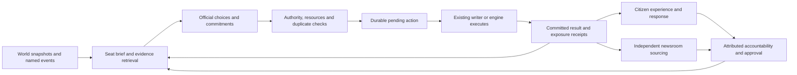

# Civic autonomy — decisions, city events, consequences and accountability

**Builder's words (2026-10-31):** "great document this as the research, and now lets build a plan that connects this to work better, crons get ample time or choices to do their work and a system that truely serves the sim, and provides citizens and the media to react to their choices and the civic officials being accountable. also when major events occur in the city they should be aware, the As havibg a parade downtown is a major event in that district, and the As winning is a moment for the cities mayor, i know there is only so much they can carry in context, the models they run also is importtant"

**Goal:** Officials independently choose grounded actions, events and programs; eligible choices change the world on a declared clock; exposed citizens and independent media can respond; the results and their attribution return to officials and approval without routine builder intervention.

**Row:** `civic.47` — one plan, one row (builder 2026-11-01). **Owner:** research-build, end to end; engine pieces are benched and pushed by this seat like any engine job. Existing `engine.260` organic civic-hire watch remains separate evidence.

This is a completed design proposal awaiting Claude review, not runtime authorization or a claim that its defaults are builder rulings. The request authorizes these documents. Model spend, production scheduling, Sheet changes, deployment and live proof retain their existing gates. Once implemented and activated under an approved policy, ordinary eligible decisions must not require another builder approval. Exceptions enter a visible technical/authority queue and never masquerade as successful civic work.

## Design decisions proposed for adoption

1. Officials choose from city evidence and their own priorities. A positive opportunity, a celebration, a quiet district and a real strain are all legitimate contexts. No default crisis story, housing premise, compulsory intervention, or authored list of eight initiatives.
2. Freeform initiative names and aims remain. A bounded set of executable simulation capabilities supplies effects, recipients, cost and duration. The official chooses an aim and a supported mechanism; the engine owns effect formulas and execution. Unsupported mechanics return a capability gap, never a cosmetic success.
3. Replies and public statements do not consume work capacity. Visits/listening only gain a material effect when an implemented receiver records one. Upkeep can cover an authorized portfolio in a bounded batch, with one receipt per initiative.
4. A mayor or district official receives a complete decision opportunity before the system calls a duty ignored. Missing data, prompt eviction, outage, an unimplemented lever and a deliberate refusal have different consequences.
5. Named major events retain their event identity, occurrence Cycle and geography across sports, city, citizen, civic and newsroom paths. Citywide significance and physical location are independent fields.
6. Officials control their own ballots and mayoral decisions on the new route. The engine validates eligibility, quorum and tally. Random outcomes may govern world effects; they do not silently replace a recorded official choice.
7. Approval responds to attributable delivery, conduct and observed response under the sim's rules. Speaking, issuing a proposal or taking credit for the A's win does not automatically earn approval. Positive, negative, mixed and indifferent reactions are possible.

## Relationship to existing work

Extend the current civic scheduler, move ledger, Initiative_Tracker, budget/upkeep/stage handlers and approval engine. Do not create a second scheduler, voter or publication pipeline. Existing Community_Programs, business/employment links, city-event carry, LifeHistory/Reflection paths, Ripple_Ledger and contract seeds are candidate receivers, mapped before changing them.

This plan proposes replacing the one-consequential-move rule, forced single-lever task, speech-as-work continuity, probability-based ballots for participating agents, and domain-only success promises. Older documents/personas that contradict current source or this accepted design get explicit supersession notes in Task A1; they are not silently treated as current. Historical proposed rows and existing programs are preserved until individually mapped. No retroactive approval or fictitious past events.

The research documents the current implementation. Tasks below specify changes. Numeric defaults here are recommended starting settings for evaluation, not measured safe rates or existing production configuration.

## The complete loop

An accepted request is pending. A committed result proves what happened. A measured result proves what changed. These must remain distinct in the brief, public record, media sources and completion accounting.

## Tasks

Task status lives only in this table. Task detail specifies scope and acceptance; it does not grant deployment authority.

| # | Task | Owner | Status |
|---|---|---|---|
| A1 | Reconcile civic facts, permissions and old contracts; freeze source/receipt baseline | research-build | persona facts landed 2026-11-01; slice fields → A2 |
| A2 | Build event-aware, model-budgeted seat briefs and bounded evidence retrieval | research-build | offline candidate `fe5746d41`; source-hash check `02d94d365`, prior-ID read `fc01458d3`; ordinary-wake proof open |
| A3 | Give each seat sufficient duty turns, independent replies, action batches and continuation receipts | research-build | inactive proposed policy `3f5bda84e`; week and event-duty proof open |
| B1 | Implement action authority, durable execution journal, resource reservations and migration contract | research-build | local contract `fe5746d41`, deterministic IDs and verified-export reconciliation `fc01458d3`, unset spend bands `3f5bda84e`; authoritative journal, reservation and migration open |
| B2 | Connect events, programs and project actions to real receivers; close typed gate defects | research-build | protected patch proposed `fe5746d41`; receivers open |
| B3 | Make official ballots and mayor decisions binding through one vote authority | research-build | local ballot contract; post-fire intents removed `a3a24d813`; pre-fire opportunity and engine binding open |
| B4 | Connect committed outcomes to citizen exposure, diverse reactions and measured accountability | research-build | strict local feed `fe5746d41`, cross-Cycle receipt read `7cab2ef59`, verified journal read `fc01458d3`; experience and approval writers open |
| A4 | Give newsroom and next official wake source-linked choices, outcomes and responses | research-build | local source and brief adapter `fe5746d41`, cross-Cycle response `7cab2ef59`; composed trace open |
| A5 | Evaluate actual seat models, context/output limits and fallback behavior on frozen scenarios | research-build | synthetic offline rubric `fe5746d41`; approved model runs open |
| AB6 | Run composed sandbox proof, pilot mayor/D2, then extend to all districts | research-build | blocked on engine, policy, schema and model gates |
| M1 | Mara as planning director: promise record, full inputs, tools, in-world memory, Sol | research-build | built; code reviewed twice; last 3 findings fixed in place, memory on her citizen page, health check deadline-aware — builder go 2026-11-03; live from the C115 Sunday run |

### Implementation map

These are existing entry points to inspect and extend, not permission to edit protected paths. New helper/test names are chosen during the assigned task; every changed producer must name its persisted output and next reader.

| Tasks | Existing entry points |
|---|---|
| A1–A3 | `scripts/buildCivicOfficeSlice.js`, `scripts/cron-civic-run.js`, `scripts/civicProblemContinuity.js`, `scripts/civic-office-map.json`; Claude-owned civic personas and schedule configuration |
| A2/A4 event export | `scripts/dumpBeatTabs.js`, `scripts/buildCivicDomainSlice.js`, `scripts/buildCivicVoicePackets.js`; sports source `phase02-world-state/applySportsSeason.js` |
| B1 execution/persistence | `scripts/applyTrackerUpdates.js`, `scripts/cityHallLedger.js`, `phase09-digest/finalizeCycleState.js`, `phase10-persistence/persistenceExecutor.js` |
| B2 capability/delivery | `lib/initiativePhaseContract.js`, `phase05-citizens/civicInitiativeEngine.js`, `phase02-world-state/applyInitiativeImplementationEffects.js`, `phase04-events/buildCityEvents.js`; program receiver `phase05-citizens/runYouthEngine.js` |
| B3 ballots | `scripts/cron-civic-run.js`, `phase05-citizens/civicInitiativeEngine.js` |
| B4 experience/approval | `phase05-citizens/generateCitizensEvents.js`, `phase05-citizens/updateCivicApprovalRatings.js`, `lib/wakePerception.js`, `scripts/citizen-wake.js` |
| A4 media/feedback | `phase07-evening-media/buildContractSeeds.js`, `scripts/buildCivicDomainSlice.js`, `scripts/buildPulseSlice.js`, `scripts/buildCivicOfficeSlice.js` |
| A5 evaluation | `scripts/modelFitRun.js`, `scripts/modelFitScore.js`, `scripts/cron-civic-run.js` |

Execution timing is part of each capability's contract. State which writer applies it, its earliest eligible Cycle, phase ordering, and when later readers can observe the committed result. A new event can refresh awareness within the same Cycle without falsely claiming an action has already executed. Respect prior-Cycle stage/effect dependencies; no universal immediate-execution promise.

### A1 — Ground the officials in the current world

Files: `scripts/buildCivicOfficeSlice.js`, `scripts/civic-office-map.json`, `.claude/agents/civic-office-*/{IDENTITY,LENS,RULES}.md`, `docs/reference/CIVIC_GAME_LOOP.md`, applicable initiative plans. Claude edits control-plane/config files; guest lanes receive bounded script jobs only.

Keep personalities, ambitions, relationships and political differences where sourced. Move changing approval, turf, program state and availability out of static personas into authoritative typed brief fields. Resolve the Baylight/D2, Montclair and Fruitvale conflicts from the current Sheet export before rewriting facts. Remove unsupported crisis premises and distinguish an official's belief/claim from measured state. Retain sourced past commitments as history with a source and Cycle, not an evergreen instruction to repeat them.

Freeze C113 mayor/D2/D9 packs, serialized prompts, accepted/rejected moves, old parade source and relevant source hashes in a local-only evaluation fixture. Reconcile exact current program state independently before any migration. Acceptance: conflicting persona assertions cannot override fresh authority; a stable district has evidence for an open choice and may choose no action for a reason.

### A2 — Situation brief with citywide event awareness

Extend `buildCivicOfficeSlice.js` and its existing loaders. Produce one versioned brief with a snapshot generation/hash, not merely a Cycle filename. Separate these bounded sections: new city/district events; measured state and recent change; official's commitments and outcomes; opportunities/resources; citizen/media response; authorized actions. A given section's cap must not erase its selected action's required evidence.

Add a normalized event view over existing exported sports/world/city-event records. Proposed fields: stable `eventId`, `sourceRef`, `sourceRevision`, `occurredCycle`, `status` (announced/occurred/cancelled/corrected), `observedAt`, `category`, `significance`, canonical `hoods`, `citywideRelevance`, entity IDs and concise sourced facts. Source coordinates plus content revision preserve identity where no stable source ID exists; headline alone is not an identity. Merge two records for the same event through an alias record rather than replaying effects.

Route a verified championship result to the mayor by citywide significance, even if no neighborhood appears in its sentence. Route the recorded Downtown parade to D2 by typed location and to the mayor by significance. Route other affected districts only when the source actually supplies their geography. Never turn an unresolved place spelling into a new hood. A sports event can belong in civic and community awareness without changing athlete identity or making an athlete a civic desk patient.

Preserve occurrence versus discovery: C111 parade discovered in a C113 export is historical awareness, not a fresh event to execute. Late correction updates the record; cancellation prevents pending event execution. Same-Cycle new events must invalidate brief caches. Ingest/adapters supplying the snapshots must expose a refresh watermark; a scheduler reading a stale C113 dump cannot claim it saw everything that happened during C113.

Start with a compact overview and a finite evidence API: retrieve event by ID, district state, project detail, budget/authority, or prior result. Implement it in the runner for models without tool support as a structured read-request round. Only whitelisted local snapshot records; returned content remains data, never instructions. If required detail is unavailable, defer that dependent action while preserving independent choices.

Recommended initial budget: total serialized input target 8,000 tokens for a district and 12,000 for mayor, including persona, continuity and instructions; reserve output/reasoning separately using each actual provider profile. These are evaluation targets, not vendor context limits. Protect urgent unacknowledged events, pending deadlines and selected-action evidence first; paginate broad boards fairly rather than alphabetically truncating them. Include omitted counts, retrieval keys and freshness. Do not feed 600-character fragments with IDs whose legal instructions were dropped.

Acceptance: actual serialized prompts contain correct event age/location, enough evidence to choose/execute, and a quiet-district opportunity; mayor citywide news survives a large board; D2 sees the parade without a sports-only persona; a stale/missing snapshot never reads as no news.

### A3 — Enough opportunity to decide and follow through

Extend the existing `datawakeRota`, `runDatawake`, week state and hourly tick. Proposed service target: two completed regular duty opportunities per civic week for each of the ten elected seats, with least-served scheduling, plus event-triggered opportunities for affected seats. The chief keeps its distinct existing authority. Reserve event capacity; a major event does not replace both ordinary work opportunities. Initial extra-event ceiling: two extra turns per elected seat per civic week, coalescing related updates into one event brief. More due work remains visible in a queue, not silently dropped.

Routine work keeps the current civic-week window. Major events arising on citizen-life days can enter the ordinary citizen wake as awareness; urgent official decisions use a bounded explicit event-duty exception proposed for rollout. Do not convert every personal wake into office work. Event delivery target: next available civic/event slot after a fresh event export, with its due clock and reason recorded. Paid execution concurrency and weekly spend ceilings are independent of eligibility.

Proposed output contract separates `statements`, `answers`, `decisions`, `upkeep` and `readRequests`. Begin evaluation with up to two independently executable decisions per duty turn, plus one bounded upkeep list and replies to relevant open demands. The official chooses the mix. Resource reservation, cooldowns, actor scope and duplicate checks govern repeated commitments across turns. More available money does not compel spending; a reasoned deliberate no-op remains legal.

Allow at most two evidence-retrieval rounds and one schema/grounding repair per decision session before deferring with the unmet need. Size deadline/output per model and task, not one 1,500-token cap. A failed API attempt is operationally attempted but not a completed opportunity for accountability. Retry with backoff; cap provider spend; deliver a later opportunity without starving other seats. A truncated response cannot count as a completed decision.

Give every action its own idempotency key. Invalid action B does not discard independent valid action A; dependent actions name dependencies and remain pending. A reply cannot be converted into upkeep or execution by wording. Accepted actions, pending work and actual results all appear in the next turn. Owed opportunities survive restarts and use the existing lock/state discipline rather than a second cron loop.

Acceptance: answering a directive and proposing/advancing useful work both survive; due maintenance across several programs can be recorded without ceremonial speeches; a provider outage does not create political neglect; duplicate cron calls cannot double-spend or double-announce.

### B1 — Authority and reliable action execution

Use the existing local move ledger as the durable pending queue. Propose a minimal engine-owned `Civic_Action_Ledger` (new schema, not an existing tab claim) as the authoritative journal of applied world changes, linked to Initiative_Tracker and existing event/program rows. Avoid storing an independent competing stage machine in both Node and Sheets. Pending local state reconciles from the authoritative journal after interruptions.

Action identity includes official/office, original decision session, ordinal and immutable payload hash. Receipt includes action kind, source evidence version, initiating event/initiative, authorization policy version, requested/effective Cycle, cost/reservation, targets, executor version, effect receipt IDs and result/reason. Propose lifecycle: submitted → validated/reserved → scheduled → applied or failed/cancelled/expired; partial writes remain reconciling with component receipts, never reported as fully applied.

Adopt authority tiers once: district officials can initiate eligible local events/services and maintain owned/turf programs within their delegated envelope; mayor can initiate citywide events/programs and coordinate several districts within executive authority; new large/ongoing appropriations use the legislative vote path. The classifier uses duration, cost, scope and obligations, not title keywords, so relabeling capital work as an event cannot evade council. Budgets derive from actual treasury/allocation state; unknown balance is unavailable, not unlimited. Numeric allocations and spend bands are a one-time policy decision/calibration, not a per-action builder prompt.

Reserve shared funds before concurrent commitments, make preconditions stale-safe, validate actor tenure, and release reservations exactly once on terminal cancellation/failure. Node requests writes through approved existing writers; engine effects use the current intent/persistence path. Define crash-after-debit and crash-after-event-write recovery before enabling two-action batches. A retry must reconcile by action identity and typed readback rather than append again. Undo is a compensating action with retained history, not deleting the original record.

Migration must map existing pending moves and open directives to stable keys and grandfather existing initiative IDs/stages/budgets without treating them as new spending. Policy rollout pauses new civic admissions, drains/reconciles in-flight writes, switches one reader/writer version, then resumes. Reverting code must leave receipts legible and must not erase actions citizens already experienced.

Acceptance: same action retried/concurrent is applied once; two seats cannot reserve the same remaining money twice; partial failure is visible and recoverable; changed office holder cannot execute the prior holder's unsigned choice as their own.

### B2 — Events and programs that actually do something

Reuse `applyInitiativeImplementationEffects.js`, `civicInitiativeEngine.js`, city-event carry, Community_Programs, business/employment receivers and the treasury path. Add missing adapters only where a measured receiver is specified. Keep one Initiative containing Projects; each project/action references its parent and target, with distinct effect receipts.

| Freeform aim implemented through | What execution must create/change | What is eligible evidence of success |
|---|---|---|
| Local celebration or recreation event | Scheduled event with canonical location, duration, resource/capacity costs; occurred receipt joins city-event carry | Actual occurrence, exposed/attending sample, local response and any defined activity/transport consequences |
| Ongoing community/youth/cultural program | Active scoped program row, start/end, capacity, funding and program reader | Participation/service use and response, not a new tracker title alone |
| Targeted service improvement | Registered health/transit/education or newly implemented domain effect, with baseline and recipient geography | Domain-specific effect receipt and later observed results, including mixed/negative results |
| Existing initiative delivery/upkeep/renewal | Existing funded stage, build clock, budget and work receipts | Maintained service, completed build, observed quality and cost; no reward for repeating the same upkeep |
| New capital/ongoing appropriation | Proposal then binding vote then existing funded lifecycle | Delivery after passage and resources; passage is not service delivery |

These are execution families, not an authored list of permitted initiatives. Actors may invent grounded projects/events in their own words. The executor resolves only supported capabilities and required entities. Novel mechanics are marked unsupported and routed as a technical gap; the official can choose a supported alternative without asking the builder to approve every idea. Do not silently translate every project into generic sentiment.

Record who initiated, authorized, funded and delivered an action separately. A mayor congratulating the A's neither causes their championship nor becomes organizer of an already completed parade. A subsequent civic choice about that event gets its own action identity, real authority and result.

Close F6 by making validated health proposals eligible for the same explicit legislative scheduling path as other proposals; measured conditions inform the choice, not an unset signature threshold that traps the row. Retain any genuinely builder-approved petition rules as a parallel route, with no unsupported conversion of sampled reflections into votes. Close F7 by implementing station-to-hood evidence for transit and using the same capability test in the pack and engine. For other domains, either build a meaningful result channel/gate or label it accurately; no forced negative penalty for an unbuilt metric exit.

Use finite duration and expiration for events; ongoing programs have upkeep, budget and renewal. Existing builders must not reinterpret an occurred feed event as an action to fund/execute again. Public promises are separate from committed changes. No blanket mood bonus for a named event; participation, accessibility, costs, disruption and preferences can affect response under declared sim rules.

Acceptance: a freeform small event reaches an existing city-event receiver and expires; a program appears to eligible citizens; a targeted service produces a distinguishable effect against a frozen control; unsupported effect language never claims delivery; health vote and transit recognition defects have composed tests.

### B3 — Votes and executive decisions are the officials' choices

Add a typed ballot/decision record keyed by initiative, vote session, office and holder at deadline. Show proposal, funded consequence, relevant local effects and other recorded positions; preserve differing personalities/models. The nine council seats decide individually. Use the actual eligible body for education (existing school-board path), not a forced council reroute.

Change `resolveCouncilVote_`/mayoral action admission for the new route to consume validated ballots and one explicit mayor response. Persist ballot tally and result together; synchronize Sunday statements from that result. No probability draw may overwrite a recorded YES/NO/sign/veto. The mayor's gavel may represent the executive decision but cannot claim a later engine result already happened.

Set deadline behavior once: unavailable/vacant seats are absent; an unanswered but available seat after its delivered opportunity is an abstention/recorded nonresponse under the body's quorum rule. Lack of quorum defers to a bounded next session and produces an unresolved institutional outcome. Technical nondelivery gets an explicit retry status, never fabricated consent. Preserve legacy resolved votes; pending legacy rows migrate explicitly or remain on the legacy resolver until marked, never both.

Acceptance: D2's recorded YES is the engine's D2 ballot; mayor veto is her recorded choice; retries produce one tally; no absent seat is silently simulated into agreement; education retains its proper voting body.

### B4 — Citizens experience outcomes; officials own the consequences

Produce exposure from the committed event/service/household/business outcome. Use real recipients, geographic reach, enrollment/use, work locations and existing social/fandom behavior where available. Citywide awareness differs from physical attendance; no attendance or quote inferred solely from living nearby. Population aggregates and tracked citizen samples retain separate denominators.

Reuse LifeHistory/Lived_Events and ordinary wake perception for realized experiences, with event/action identity and once-per-recipient delivery receipts. Do not guarantee every affected person wakes; expose the event when eligible citizens are drawn and measure coverage separately. Existing receipt/spool/lock rules must survive retries and midnight/Cycle boundaries. An event being offered in a prompt is not a saved reaction.

Citizens may welcome, dislike, ignore or question the choice based on their circumstances and traits. A service can help and still be unpopular; a popular event can have costs. The model cannot set objective outcome numbers by praising it. Persist subjective response with source/actor/experience identity and confidence/availability. Return dissent and indifference alongside praise; speech is not a representative poll.

Extend the existing approval calculation with a traceable component breakdown: district/city background, attributable delivered benefit or harm, fulfilled/broken commitments, constituent response sample and published coverage. Decide weights once through a versioned policy and matched sandbox evaluation. Avoid double credit when an initiative's same effect appears as stage progress, neighborhood mood, citizen reflection and newspaper story. Preserve the general background term but identify it separately; one sports win must not generate four attributed civic rewards.

Only charge avoidable inaction when the seat was in office, received relevant evidence with enough time, had executable authority/resources, and had a completed opportunity. Queue failures, missing facts, an unbuilt capability and an unscheduled task do not prove civic neglect. A specific promise's deadline and actual result matter; an ordinary positive sick count is not an overdue personal obligation.

Acceptance: two exposed citizens can disagree; an unexposed citizen can know only the public story; delayed/cancelled work produces honest follow-up; a missing model call creates operational debt, not approval punishment; replay does not duplicate a reaction or approval component.

### A4 — Citizens, media and the next official turn share the evidence

Extend current ripple/contract-seed/beat-slice and citizen pulse paths. Carry event/action IDs through storage/export, including the underlying cause identity when existing contract seeds cluster by cause and neighborhood. A useful story contains the official's choice/claim, what executed, who was affected, measured changes, costs, public responses and unresolved promises. Preserve source IDs in machine receipts while rendering natural in-world text to agents/readers.

The civic, sports, community and business desks may independently find relevance in the same major event. Do not duplicate source events or force all desks to publish. A sports championship is relevant to the mayor; a Downtown parade is relevant to D2; business/transit angles require their own receipts. Published coverage may affect approval through existing coverage feedback, but drafts, a suggested seed and an official's assertion are not published evidence.

The next official brief shows each previous decision's accepted/applied/failed/pending state, effect and reaction window, source-linked coverage and due commitments. Answering a question does not clear a delivery obligation. Repeated paperwork language must not recursively generate more paperwork tasks.

Acceptance: one decision can be traced into a citizen experience, an eligible independent media source and the next official pack without a manual prompt; no invented quote or publication; one published story's feedback counted once. Respect all three existing publication pipelines and their canon gates.

### A5 — Fit models to the work and the context they actually see

Current configured families: mayor Kimi K2; OPP DeepSeek v4 flash; IND Llama 4 Maverick; CRC Gemini 3.7 flash. Preserve deliberate family/voice diversity while evaluating quality. Source names are configuration observations, not a recommendation about current vendor availability. Reuse the existing model-fit plan/runner/scorer after adapting the new decision contract. Do not inherit its old prices or context claims.

Before an approved paid run, verify provider support, context and output/reasoning limits, synchronous/batch behavior and current cost for each configured candidate. Store a dated per-model profile. Preserve complete receipts: requested/answered model, provider, schema version, input hash and token count, completion and reasoning usage, finish reason, elapsed time, retries, dollars and result validity. Unknown cost remains unknown. Budget exhaustion cannot become a successful empty response.

Recommended evaluation starts with the A2 input targets and 3,000 visible output tokens for a district work session, 5,000 for broad mayor coordination, plus bounded reasoning where the provider requires it. Adjust using observed truncation/quality/cost; these numbers do not claim that extra tokens improve decisions. Expand a task's opportunity through targeted retrieval/continuation instead of continually growing every prompt. Short public reactions can use smaller budgets.

Freeze scenario pairs: stable district with a positive opportunity; measured strain; major city victory; Downtown parade; several due programs; a directive plus useful action; conflicting sources; unavailable resources; failed/cancelled action; binding vote; full mayor board; same-Cycle event update. Synthetic cases are visibly synthetic and local only. Historical C111 parade retains its actual time. Compare each model on its own persona across repeated samples; do not interpret a model-family political difference as model quality.

Score executable grounded choices, useful distinct options, event/time/geography awareness, honest uncertainty, follow-through, distinct character, resource discipline, output completeness, latency and cost. Do not score number of actions, positivity or approval gain as model intelligence. Hard contract failures cannot be offset by eloquent voice. Blind-read voice/choice quality, pre-register scoring and cost ceiling, and evaluate fallback profiles too. Policy/JSON repair cannot turn one model's choice into another's without a new recorded decision attempt.

Acceptance: every selected model can finish the real serialized scenarios within its profile; no unseen evidence credited as read; no silent provider fallback or truncated completion; family diversity and cost tradeoffs documented. No model replacement is chosen by this document alone.

### AB6 — Delivery sequence and proof

Order: A1 baseline → A2 brief/event adapter and B1 authority/journal contract in parallel → A3 opportunities and B2 receivers → B3 votes and B4 reactions → A4 feedback → A5 model comparison → composed pilot. A5 fixtures/scoring can be prepared earlier; paid evaluation waits for stable contracts and its spending approval. Do not deploy action producers before their receipts, consumers and budgets exist.

Use focused behavior tests around existing suites (`buildCivicOfficeSlice.test.js`, `cron-civic-tick.test.js`, civic petition/stage/approval suites, wake-perception and media slice tests) plus new integration fixtures where the contract crosses components. Pure local replay uses fake writers and visibly synthetic identities. Preserve seeds and source inputs for a matched sandbox control; verify the actual state writes and later readers, not just source strings or log lines.

First pilot cohort: mayor and D2, because the builder's championship/parade case exercises citywide plus district authority; add a stable district case such as the saved D9 scenario as a local/sandbox fixture. No stale parade replay into production. Prove one short event and one service/program path before expanding all ten elected seats. A meaningful comparison includes an eligible negative/mixed outcome, no-op, absent official, transport failure and partial-write recovery, not only a happy path.

Use the existing Groundhog sandbox procedure and preserve production locks/admissions. Before live activation, Claude reviews exact schema/cron/model/policy diff, migration manifest, candidate version and rollback. Live operation retains existing cycle-fire authority. Once active, no per-action builder work is needed for ordinary actions within policy.

### M1 — Mara as the city's planning director: memory, promise record, tools

**Builder direction (2026-11-02, verbatim in Changelog):** Mara is "a reasoning agent that needs time and tools"; her memory is essential; "she is what keeps the civic voices honest, if a civic office make a promuse or says its going to do something Mara keeps that in front of them"; she "would ask a civic office about the A's parade in their district, why kono keeps showing up as a health crisis". Answers the same day: project directors return as addressees; the edition audit returns only if it shows a benefit; model Sol. Go on this design to Codex review: "Approved to go". **No build until the builder approves this section after the review.**

**Current mechanism (source: `scripts/cron-civic-run.js` `runDirective`, Codex review `docs/for-claude-review/2026-11-02-codex-mara-directive-review.md`):** one non-tool call (Gemini 3.8 flash) after the Sunday close. Addressees are pre-selected by code (elected seats passed over, ≥3 complaints with no pending proposal, or a board row with `NextActionCycle ≤ N+1`). Every block must carry Address, Why, Acceptance and Silence consequence; zero valid blocks halts the stage. Inputs: world-summary sections, engine HIGH patterns, tracker, a 400-character gist of each office's prior-Cycle statement, the previous directive (≤6,000 characters). Nothing reads or writes the `mara` Supermemory container, her citizen page (POP-00507, one C103 reflection), the paper or the weekday statements. Weekday confrontation IDs accumulate from every AUTO file until answered: the C114 mayor pack holds 8 open (C103–C114), D4 holds 5; D4's 2026-11-02 weekday statement asks the Clerk to "restore the missing directive text… a list of directive IDs alone is not enough".

**Design.**

1. **Role.** Planning director who holds offices to their own word and asks about what is happening in their districts. Kinds of directive: *promise check* (an office said it would do X — status?), *event question* (the A's parade crossed your district — what is your office doing?), *record question* (KONO's health reading keeps repeating — what does your office see?), *stall* (a dated tracker step is past due). A quiet, flourishing week may produce no directive. Prompt text loses "confront", "owe", "the crisis and the success", "must fight for their constituents" and the pre-supposed default/charter language (Codex findings 2, 3).
2. **Addressees.** Mayor, nine council seats, and the five project directors (`LAYER3_DIRS`: Baylight, Stabilization Fund, OARI, Health Center, Transit Hub). Code no longer pre-selects a target set; it supplies per-seat evidence and the eligible roster. Validation: a block's Agent must be on the roster (unchanged rejection path for anything else).
3. **Block format.** Required: Agent, Address, Why (cites a Cycle and its source), Acceptance. Optional: Silence consequence (kept as a field name when present, so old readers parse). Output also carries a `## Not directing` section: one line per office she looked at and chose not to direct, with the reason, office named by person and title only — no `**Agent:**` line, no agent directory id, no `.claude/agents/` path (validator rejects the section if it contains any `civic-office-`/`civic-project-` id). `runDirective` parses this section out *before* `filterDirectiveBlocks` and writes it after the blocks. Zero blocks plus a nonempty `Not directing` section is a valid result (AUTO + manifest); zero blocks and no section remains a halt with raw output kept (Codex finding 4). Readers (Codex M1 review finding 3): Sunday prep's per-seat extractor (`cron-civic-run.js:764`) changes from "first `## ` section containing the dir id anywhere" to "every section whose `**Agent:**` line names `.claude/agents/<dir>/`"; `buildInitiativePackets.js` strips the `## Not directing` section before its full-directive copy, and on a zero-block week copies nothing; `loadConfrontations` already requires an Agent line. Each reader gets a fixture test with a Not directing section and a zero-block AUTO.
4. **Promise record** (new, `output/mara-directives/promises.jsonl`, append-only; nothing is edited). Mara writes it through a `promise_record` tool. Codex M1 finding 2 folded:
   - *Sources are allowlisted, not model paths.* She cites `{kind: sunday|weekday, office (agentDir), statement?, cycle, date?, field, index?}`; code resolves the file itself — Sunday `output/civic-voice/<file>_c<N>.json`, where `<file>` comes from a fixed table keyed by agentDir: the mayor has two Sunday sources and `statement: open|gavel` is required to pick `mayor_open` or `mayor_gavel` (re-review finding 2); every other seat has one (`voiceSlug`). Code checks the resolved file's `office` field against the table before reading; weekday `output/cron-civic/datawake/<agentDir>_<date>.json` within the Cycle week. No other path is readable through the tool.
   - *Only public-statement fields count.* Sunday: `statements[i].quote`, `statements[i].fullStatement`, `statements[i].decision`; weekday: `statement`. Not `trackerUpdates`, `cascadeSummary`, `moves` payloads or answer payloads. The quote must be a substring of that parsed JSON string value after whitespace normalization (collapse runs, trim, straight quotes) — never the serialized file bytes. Speaker = the file's `office`/`agentDir`, not a model field.
   - *Identity is fixed.* `promiseId` = hash of (agentDir, source cycle/date, field path, normalized quote); the first row is the promise and is never superseded. Later rows are *status rows* `{eventId, promiseId, cycle, status: kept|dropped|changed, evidence}`. Re-review finding 3: provenance alone cannot close a promise; evidence must be tied to *this* promise by construction, one of two ways: (a) the promise carries the `initiativeId` of the statement it came from, and the evidence is that initiative's tracker field quoted exactly (`InitiativeID`, field, value) or a later statement of the same office carrying the same initiative id; or (b) Mara put the promise in front of the office in a directive block (`**Promise:** <promiseId>` line), and the evidence is that office's answer bound to that block's confrontation ID (weekday answer move, or a director's `maraAnswer`, item 11). Anything else is rejected and the promise stays open and in front of her.
   - *Code re-review finding 1, builder go 2026-11-03.* `kept` from the tracker needs an `ImplementationPhase` move since the promise — `Status` is the legislative arc and advances from the vote alone, so it never shows a kept promise (`dropped` still needs a terminal `Status`; `changed` a moved `NextActionCycle`/`NextScheduledAction`). A close on an office's own statement or answer is Mara's reading of that office's words: she quotes the words she relies on (checked against the reply or statement), and the status row carries `basis: office-word`; her run entry says "on the office's word". A deferral still closes nothing.
   - Rejections are logged in the manifest. Her next run gets every promise not closed by a validated status, in full. This is her answer to "keeps that in front of them"; it is hers, not a scorer.
5. **Inputs (full text, no character caps — builder 2026-11-01):** the open promise record; her last three directives (AUTO or manual); every office's full Sunday statement for the Cycle (voices, mayor open/gavel, project outputs) and every weekday datawake statement from the week before the close (`output/cron-civic/datawake/*_<date>.json` records carrying the previous Cycle number, `statement` + `moves` in full); world summary (all sections); engine HIGH patterns; tracker with each row's `Status` and `NextActionCycle`; answer moves to her prior directives from the move ledger; the Cycle's edition if `editions/cycle_pulse_c<N>.txt` exists.
6. **Tools** (OpenRouter tool loop; extend `openRouterToolLoop` in `scripts/cron-desk-writer.js` with optional `opts.exec`, `opts.resultCap`, `opts.timeoutMs`; existing callers pass none and behave as now): `canon_recall` (bay-tribune container — what the paper published, by Cycle), `citizen_lookup`, `sheet_read` (existing allowlist), `memory_recall` / `memory_note` on her own citizen page POP-00507 (item 7, builder 2026-11-03), `promise_record`. Tool budget starts at 8 calls (loop default 6). Codex M1 finding 7 folded: per-request timeout (`callOpenRouterRaw` has none today) set for a reasoning run; Mara's tool results are not cut at 8,000 characters (no-caps rule; each result's size goes in the trace); **write tools are staged, not executed** — `promise_record`, `memory_note` and the `mara-world` run entry are collected during the loop; a run that fails before validation writes nothing. Re-review finding 4, the commit after validation: every staged write carries a stable event id (promise rows: the promise hash; status rows: hash of promiseId, cycle, status, evidence; her page run entry: customId `cp-POP-00507-c<N>-directive-run` (item 7); page note: customId per Cycle). Order: AUTO + manifest (as now), then the remote memory writes (upsert by customId, each read back), then the local promise rows (appended only if their event id is not already in the file). Each write's outcome goes into a commit receipt `output/mara-directives/commit_c<N>.json`; any failure marks the manifest `commit: partial`, and re-running the stage for that Cycle reads the receipt and redoes only what is missing — a write already present is skipped, so nothing is written twice; cost metered from OpenRouter's returned usage cost, with an `openai/gpt-6.1-sol` entry ($2/$10 per M) added to the local rate table as fallback (today unknown models default to $0.50/$1.50).
7. **Memory — her citizen page (builder 2026-11-03, supersedes the `mara-world` split below).** Builder, verbatim: "agree on mara memory, mara should be using her wiki container as the mara container has alot about me an ideas". Her memory is her own page, `cp-POP-00507` (`scripts/maraMemory.js`); no `mara-world` container is made and the cron never reads `mara`. The three approved entries (vote records, Baylight legal instruments, justice and public safety roster) were copied onto the page 2026-11-03 by `scripts/maraMemorySeed.js` after the screen, read back, receipt `output/mara-directives/mara-memory-seed-receipt.json`. Her weekly run entry (`cp-POP-00507-c<N>-directive-run`) and the seeds are desk records (`metadata.type: desk-record`), so the page scanners that admit only `reflection`/`tension` never read them as her own words; her up-to-three `memory_note`s stay page notes. One tool, `memory_recall`, reads the page — the newest entries plus a query search — and says "unavailable" (never "empty") when the read fails. The original split text follows as history.
   *Superseded:* **Memory — split of the `mara` container (approved shape).** The `mara` container holds the manual claude.ai Mara's history including out-of-world entries about the builder; a cron reading it whole breaks Rule 3. Split: a new in-world container (`mara-world`) receives the in-world entries of `mara` (directive history C74–C103, satisfaction record, Baylight Phase II gates C103/C108/C111, etc.); out-of-world entries are not copied; `mara` itself is left as it is (no delete; the claude.ai Mara keeps using it). Codex M1 finding 6 folded:
   - *Copy gate is testable.* The candidate list is written to a file first (entry text + source id). A screen script rejects any entry naming the builder, the real-world project, a session/terminal/repo/cron/model/prompt, or "Owner"; this seat reads every passing entry; the builder sees the list before anything is written. A copy receipt (ids written, ids rejected, readback count) is committed.
   - *Writer and readback.* `lib/supermemory.js` has search only; the write uses the `/v3/documents` add path `lib/citizenPage.js` already uses, followed by a readback by customId. A run entry that fails readback is a manifest error, not silent.
   - *Read failure is not empty memory.* `lib/supermemory` returns `[]` on error or missing key; the `mara_memory` tool distinguishes "no match" from "memory unavailable" (status/error checked) and says which; the manifest records it. No fallback to `mara`, ever.
   - *(superseded by the builder's 2026-11-03 word above)* Her citizen page (POP-00507) stays her own: `memory_recall`/`memory_note` only, nothing seeded onto it by this seat (Rule 4).
8. **Model.** `openai/gpt-6.1-sol`, reasoning on, default in `runDirective` (`--model` still overrides and still passes the friction check). Friction rule holds (OpenAI ≠ the mayor's Kimi). OpenAI is already a writer family (D2/D4 GPT-6 Luna), so the gate's pick (Anthropic Haiku 5.5) is unchanged. Fallback on transport failure or timeout: one retry, then Gemini 3.8 flash without tools; the manifest `model` records the model that actually wrote (the gate reads it). Cost (Codex M1 review, measured C114 input ≈221k characters ≈55k tokens): ≈$0.11 input per request; 8 tool calls = 9 requests ≈ **$1.10–$1.30 per weekly run** before tool-result growth and reasoning output; real figure from the proof run.
9. **Data fix (Codex finding 1).** `seatUnansweredDemands` and the duplicated seat-material predicate: `NextActionCycle` must be a nonblank finite integer; rows with terminal/failed `Status` excluded; "due C<N+1>" (scheduled) reported separately from "past due". `boardRowsFor` copies `nextActionCycle` so the seat sees the date Mara cites. These become evidence lines, not target triggers. The petition count stays an evidence line ("7 complaints on record, no proposal pending"), not a rule.
10. **Open confrontations** (Codex M1 finding 4 folded). `loadConfrontations` keeps `all` and `answeredIds` from every AUTO file (history: `loadProblemContinuity` and `civicProblemContinuity.js` need old answers' `sourceText` for hood inference); `open` is limited to blocks from the **latest directive Cycle globally** — a valid zero-block AUTO counts as latest and leaves nothing open. Not latest-per-seat: that would resurrect an old block for a seat the new directive left alone. An older unanswered block stays open only if Mara re-issues it (she sees her last three directives and the answers). The weekday reader reads AUTO files only; a manual file stays prep's alone (build note 2026-11-03: none exist on disk, and a manual `c<N+1>` file's Cycle would sit ahead of the week's answers, which bind only to an earlier-or-same Cycle). Nothing is deleted. Transition, measured on the local C114 snapshot: at deploy, open items are the C114 blocks only — seven elected addressees (`mara_directive_c114_AUTO.txt`), minus any already answered (D4's C114 answer is pending, so D4 has none); D6, D7, D9 and the project directors have none. Those C114 blocks rest on the blank-date false stall clocks (Codex finding 1); they clear when the C115 directive is written.
11. **Project directors** (Codex M1 finding 1 folded). Today a director gets a Sunday turn only when a mayor/council statement touches its initiative (`statementsTouching`, `cron-civic-run.js:1540-1555,2071`), and prep writes its packet only when `assignments[dir]` exists (`:654-684`); the initiative-packet copy is never read by the cron. Change: a director addressed in the prior directive is a trigger on its own — prep writes its packet with its Mara section, and the projects stage runs it even with no touching statement. Re-review finding 1: a turn triggered only by Mara gets its own prompt — Mara's question (Address, Why) and the director's record, asking for a factual answer or an honest "not known yet, and when it will be"; no operational decision, `trackerUpdates` or phase move is asked for, and none is accepted unless a dated step is due that Cycle. Output adds `maraAnswer: {confrontationId, kind: answer|deferral, text}` to the project JSON (`output/civic-voice/<slug>_c<N>.json`); when a director is also triggered by a touching statement, the normal project prompt runs and `maraAnswer` is added to it. Mara reads only `maraAnswer` as the reply to her question — other project content is not taken as satisfaction. No weekday route is added for directors. Code re-review findings 2–3 (builder go 2026-11-03): on a Mara-only turn every statement is `type: reply` with the decision exactly "Reply to the City Planning Director" — nothing else is accepted, so no operational decision rides in; when the dated step is due, `trackerUpdates.initiative` (and any statement `initiative`) must be the director's own initiative.
12. **Weekday prompt** (Codex M1 finding 5). `cron-civic-run.js:2438` "An {"type":"answer",...} move responding to it is expected" → neutral: Mara asked this; to reply, use an answer move bound to its id. Project directors' RULES passages on Mara (`.claude/agents/civic-project-{oari,health-center,stabilization-fund}/RULES.md`, Mara-as-political-pressure lines) are rewritten to the planning-director role inside this job (civic personas are civic.47's, as in A1). **Builder ruling 2026-11-03 (verbatim in Changelog): directors move "when the deadlines call for it", not every week.** In scope: the directors' "Advance the story / each cycle must be different / every cycle must move forward" hard rules (OARI :164, Health Center :183, Stabilization Fund :233) become: move when the calendar calls for it (the step due this Cycle, or a deliverable that has landed); between deadlines, report what is in progress without inventing movement; a missed deadline is reported honestly. The prep line attached to a stuck-initiative pattern, "This is a decision demand, not a briefing. Advance the phase or take a fail phase. Silence fails the apply gate." (`cron-civic-run.js:629`), is removed for the same reason.
13a. **Weekly health check, deadline-aware** (builder 2026-11-03: "you can fold that into this job"). `scripts/engine-auditor/detectStuckInitiatives.js` 1.5.0: a phase held while the next dated step is still ahead (`NextActionCycle` > the Cycle) is the calendar, not a stall — no stuck pattern; a step due or past due, or no dated step, keeps the 3-Cycle tenure rule; a finished program (final `Status`: failed, withdrawn, …) is not stuck. Evidence carries `NextActionCycle`. Its HIGH patterns feed Mara's material and the newsroom, so the old every-week rule no longer reaches her as "stuck".
13. **Edition audit.** Not rebuilt. After three Sunday runs, compare what she raised from the paper with the newsroom reviewers' findings; bring it to the builder only if she catches what they do not.

**Downstream checked (Codex reviews 2026-11-02 §Downstream contract and 2026-11-03):** Sunday prep extractor — changed to exact Agent-line match (item 3); initiative-packet copy — strips Not directing (item 3); week carry does not parse fields; weekday reader needs Agent and Address — kept; `civicProblemContinuity` infers hoods from `sourceText` — a new-format Why/Address naming several hoods makes an answer touch all of them (current behavior), shown in a fixture; the gate reads the manifest's `model` — the actual writer (item 8); stage completion reads manifest existence — a zero-block run still writes one.

**Weakest points, attacked:**
- *Sol does not call tools or loops too long* (research.29 saw seats make few calls). Proof run on C114 inputs counts tool calls; a run with zero calls still produces a valid directive from the full inputs, so tools are an addition, not a dependency.
- *Promise record drifts from what was said.* Allowlisted sources, public-statement fields only, normalized substring on the parsed value, fixed identity, and evidence-checked status rows (item 4).
- *Removing pre-selection lets her direct everyone every week.* Prompt rule plus manifest count; the proof run reports blocks per seat. No numeric cap is set by this seat — if a week produces too many, that is the builder's call.
- *Memory leak of the builder.* The cron never reads `mara`; her page gets only the three screened in-world entries plus her own run entries and notes (item 7).
- *Cost.* Codex's measured C114 estimate is ≈$1.10–$1.30 per weekly run at 8 calls (item 8); the proof run reports the billed figure and the builder hears it before the live go.
- *Writes from a failed run.* Staged writes commit only after validation; the commit receipt and event ids make a partial commit resumable without duplicates (item 6).

**Files:** `scripts/cron-civic-run.js` (runDirective, brief, prompt, filter, target evidence, model default, prep extractor, project trigger, weekday answer line), `scripts/buildCivicOfficeSlice.js` (`boardRowsFor`, `loadConfrontations`), `scripts/buildInitiativePackets.js` (strip Not directing), `scripts/cron-desk-writer.js` (optional exec/resultCap/timeout, Sol rate), `lib/supermemory.js` (status-bearing search for `mara_memory`) or a Mara-local wrapper, new promise-record module, `mara-world` copy + screen script, `.claude/agents/civic-project-{oari,health-center,stabilization-fund}/RULES.md` (Mara passages and the every-Cycle movement rule); `docs/mara-vance/IN_WORLD_CHARACTER.md` unchanged. Tests: directive target/filter suites, `buildCivicOfficeSlice.test.js`, prep-route, initiative-packet copy, promise-record validation (allowlist, field, normalization, identity, evidence), staged-write/no-duplicate and partial-commit resume, mayor open/gavel source resolution, promise status relation (a)/(b), Mara-only director turn with `maraAnswer`, memory-unavailable, C115 zero-block clears C114 open while old answers keep resolving their hoods.

**Proof before live:** all civic suites pass; one directive run on C114 inputs in an isolated worktree (live `output/` untouched — the C115 prep reads the live C114 AUTO); report blocks, not-directing lines, promise rows written/rejected, tool calls, tokens and cost (the proof run stages every write and commits none: no `mara-world` entry, no citizen-page note, no live promise file); Codex reviews the exact diff and the proof output; builder's go; first live run is the C115 Sunday chain.

**Acceptance:** a directive run (a) writes a valid AUTO + manifest with zero or more blocks and a Not directing section, (b) cites only promises that validate against their source, (c) addresses only roster seats including project directors when warranted, (d) contains none of the removed crisis/compulsion language, (e) leaves open only the latest directive's blocks, (f) records the actual writer model, tool calls and billed cost in the manifest, (g) gives an addressed project director a Sunday turn the following week whose `maraAnswer` is the only reply Mara counts, (h) writes nothing when the run fails before validation, and after a failure during the commit a re-run completes it with no duplicate row or note, (i) closes a promise only on evidence tied to it, (j) director RULES and prep text no longer require movement outside a due step.

## Acceptance

| Proof | Required observable result | Evidence layer |
|---|---|---|
| Major-event awareness | One source event yields mayor citywide awareness and D2 local awareness; historical parade stays C111; corrections and cancellations propagate | Frozen adapter/serialized prompt replay, then approved ordinary wake receipt |
| Opportunity | Ten elected seats receive their two regular duty opportunities when healthy; event duty and technical retry do not erase them | Scheduler simulation with restarts/outages, then one complete civic-week receipt |
| Choice capacity | Reply, independently valid decisions and upkeep coexist; invalid/dependent action handling is visible | Validator + fold + executor integration fixture |
| Small action | Event occurs once, expires, consumes actual resources and reaches citizen/media inputs | Sandbox typed readbacks and downstream receiver receipts |
| Ongoing action | Program or service persists, is used, costs resources, and can be renewed/changed | Multi-Cycle matched sandbox pair and actual table reads |
| Votes | Named recorded ballots/sign/veto determine the single authoritative result | Engine integration test including absent seats and replay |
| Reaction | Trace action/event to saved citizen experience and optional reaction without forced praise or fabricated attendance | Citizen wake/page receipt joined to committed source |
| Media | The same source reaches appropriate desks; publication remains independent and gated | Source/packet manifest; approved published receipt only if publication occurs |
| Accountability | Attributable effects and background factors are distinguishable; omission/outage/ignorance not conflated | Approval component receipt with dedup and counterfactual checks |
| Persistence | Crash after reservation/write/readback and concurrent seats converge without duplicate effects | Failure-injection fixture and sandbox reconciliation readback |
| Model fit | Actual prompt, response completeness, choice quality, voice and cost recorded per profile/fallback | Approved frozen model comparison, no cached-packet shortcut |
| Autonomy | One event path and one program path return results/reactions to the next official wake with zero manual content/tracker edits | Full composed pilot manifest; after activation, ordinary production receipt |

No single unit test, applied=true file, stage transition, quoted reaction or aggregate approval increase substitutes for the complete chain. Research/source proof, local fixtures, paid model results, sandbox outcomes, deployed version and live operation are reported separately.

## Reviews reconciled

| Review | Lane | Pointer | Result |
|---|---|---|---|
| Source investigation and C113 examples | codex | [[../research/2026-10-31-codex-civic-autonomy-research]] | read-only; F1–F12 carried into tasks |

### Agreed

| # | Item | Held by | Sources |
|---|---|---|---|
| A1 | Sim data and actual choices govern; events and positive life are valid civic work | builder | Builder direction above; research §Builder direction |
| A2 | Major city moments reach mayor and affected districts | builder | Builder direction above; research F11 |
| A3 | Existing source has one-move, clipping, ballot and typed-gate gaps | codex | Research F3–F9, F12 |

### Needs proof

| # | Claim | Held by | Proof that settles it | Sources |
|---|---|---|---|---|
| P1 | Proposed opportunities and token profiles give enough time at acceptable cost | codex proposal | Scheduler cases and approved A5 comparison | A2/A3/A5; research model inventory |
| P2 | Small events/programs reach citizens and media with real effects | codex proposal | B2/B4/A4 composed sandbox chain | Research existing receivers |
| P3 | Attributed approval avoids double counting and rewards actual delivery | codex proposal | B4 matched controls and component receipts | Research current approval path |
| P4 | The new durable journal survives partial failure and migration | codex proposal | B1 failure injection and AB6 readback | Research current fold/apply boundary |

### New concepts

| # | Concept | Origin | What it adds | Status |
|---|---|---|---|---|
| N1 | Event-specific citywide/local awareness and bounded retrieval | builder request; codex mechanism | Mayor and district see the same event from their responsibilities | proposed in A2/A3 |
| N2 | Separate replies, decisions and portfolio upkeep | codex; research F3/F4 | Replies stop crowding out delivery | proposed in A3 |
| N3 | Delegated small actions plus an applied-action journal | codex | Events/programs have direct receivers and auditability | proposed in B1/B2 |
| N4 | Binding agent ballots and deadline policy | codex; research F9 | Political choices determine votes | proposed in B3 |
| N5 | Experience-linked response and attributable accountability | builder request; codex mechanism | Officials see who was affected and what actually followed | proposed in B4/A4 |

## Open questions

- **Builder's call, remaining forced frame (Codex inventory, review file above):** removed 2026-11-02 on his pick (1, 3, 4 — Changelog): "No decision is not an option", the weekday must-answer lever, the required `problem`. Still open: the directive's Silence consequence and "the crisis and the success" — proposed in M1; no category or budget under $1M fits a small event. Project-director movement answered 2026-11-03 (on deadlines, not every week — M1 item 12).
- **Builder 2026-11-01, no design yet:** city workers (the police chief is his example) track city data and work with the district offices on their issues, so the agents run the administration of the city. He does not have the solution yet; do not build from this line. Verbatim in Changelog.
- Claude/builder acceptance should ratify or adjust the proposed opportunity/action/retrieval defaults, event-duty exception and delegated budget authority once. This blocks production policy activation, not offline implementation/specification. **Builder 2026-11-01 (verbatim, see Changelog):** token budgets — "No cap is the rule"; turn counts — "codex plan not mine"; event-duty exception — not answered. The numeric targets in A2/A3/A5 are not builder rulings.
- **Builder 2026-11-01 selected "Use proposed defaults behind pilot flag (Recommended)."** This supersedes the earlier unanswered offline-policy choice: `scripts/civic47PilotPolicy.js` v1 encodes two regular opportunities, up to two extra event opportunities, and a Fri/Sat event-duty exception under explicit `--civic47-pilot` only. No crontab or live schedule changed. The plan specifies no numeric delegated spend or event-duration bands, so those fields are null and delegation remains unavailable until amounts are supplied; this selection does not authorize invented budgets or production activation.
- Engine-sheet must map event/program execution capabilities and choose concrete effect rates against existing sim scales; no new housing premise or guaranteed approval gain. This blocks B2 receiver activation.
- Bind the execution journal to the exact existing persistence guarantees before choosing its final columns/storage. A proposed new tab is not authority to create it now. This blocks B1 external writes.
- Approve an A5 model-comparison spending ceiling after the frozen matrix and current provider facts are ready. No new vendor model is selected here; existing model-family diversity remains the starting constraint.
- Claude assigns the coordinating rollout ID/terminal pointer and resolves overlaps with existing civic plans and engine.260. No rollout row or protected handoff is changed by this delivery.

## Changelog

- 2026-11-03 (research-build) — **Builder go on the code re-review findings, memory home, health check, push — verbatim:** "go on your 4 purposed fixes, agree on mara memory, mara should be using her wiki container as the mara container has alot about me an ideas, you can fold that into this job, you can push when finished". Fixed in place, no third review round (TERMINAL.md §Review 4): (1) `kept` from the tracker needs a work-stage move, never `Status`; a close on an office's words quotes them and is marked `office-word` (item 4); (2) a Mara-only director reply is only a reply (item 11); (3) a due step moves only the director's own initiative (item 11); (4) the weekly health check is deadline-aware (item 13a). Memory: her citizen page, not a new container; the three approved entries copied with readback (item 7). Code review files: `docs/for-claude-review/2026-11-03-codex-mara-m1-code-review.md`, `…-code-rereview.md`. Pushed on the builder's word without a Codex pass on the final fold.

- 2026-11-03 (research-build) — **Builder: write the four in; directors move on deadlines, verbatim:** "Let’s write them in, and hey don’t have to move it every week , it’s moving it when the deadlines call for it ," — the re-review's four findings folded into M1 without a third review round (items 4, 6, 11): mayor open/gavel source key; a promise closes only on evidence tied to it (its initiative's tracker field, or the office's answer to the block that carried it); commit receipt + event ids so a partial commit resumes without duplicates; a Mara-only director turn answers her question (`maraAnswer`) with no decision required. The deadline ruling answers the open forced-frame item on project directors: their every-Cycle movement rules and the prep's stuck-initiative "decision demand" line come out (item 12).
- 2026-11-03 (research-build) — **M1 re-review HOLD, review limit reached** (`docs/for-claude-review/2026-11-03-codex-mara-m1-design-rereview.md`): findings 3–7 of the first round folded; four left — (1) a project turn triggered only by Mara has no prompt that lets the director answer her question without making an operational decision; (2) the promise source key cannot tell the mayor's open statement from the gavel statement; (3) a status row can close a promise with evidence that does not speak to it; (4) a failure after validation, during the memory and promise writes, can leave a partial write or a duplicate status row. Goes to the builder: fix in place or record and close. No build.
- 2026-11-03 (research-build) — **M1 Codex review HOLD, folded** (`docs/for-claude-review/2026-11-03-codex-mara-m1-design-review.md`, 7 findings, each checked against source): (1) project directors get a Sunday turn when Mara addresses them — today only a touching council statement triggers one and the initiative-packet copy is never read by the cron; (2) promise record — allowlisted sources, public-statement fields only, normalized match on the parsed value, fixed identity, evidence-checked status; (3) Not directing — prep extractor matches the Agent line exactly, the initiative copy strips the section; (4) open confrontations = the latest directive Cycle globally, history kept for hood inference, C114 transition restated from the snapshot; (5) weekday "answer is expected" line neutralized and project RULES Mara passages rewritten — the every-Cycle movement rule stays the builder's open item; (6) memory copy gate, writer + readback, unavailable ≠ empty, no fallback to `mara`; (7) per-request timeout, no result truncation, staged writes committed after validation, Sol metering. Cost from Codex's measured C114 input: ≈$1.10–$1.30 per weekly run. Re-review next (the one allowed).
- 2026-11-03 (research-build) — **Builder go on the Mara design, verbatim:** "Approved to go" — on the reply proposing: Sunday after the close; addresses mayor, council, project directors; reads her own promise record, the week's full statements, the paper, the summary, the tracker with the date bug fixed; tools for memory, canon, citizen/hood lookup; writes directives only where a promise slips or something real deserves an answer, a not-directing list, and notes to memory; Silence consequence optional; no-directive weeks allowed. Written as Task M1; Codex review next; no build until he approves M1 after the review.
- 2026-11-02 (research-build) — **Builder answers on Mara, verbatim:** "1 - yes, 2 maybe if we benefit from it,3.  sol maybe?" — (1) project directors return as addressees; (2) the edition audit returns only if it shows a benefit; (3) model: Sol. Checked: `openai/gpt-6.1-sol` is live on OpenRouter ($2/M in, $10/M out, tools + reasoning, 1M context). OpenAI is already a seat family (GPT-6 Luna, D2/D4), so it adds no new writer family and does not take the gate's first pick (Anthropic Haiku); it differs from the mayor's Kimi, as the directive friction rule requires. No build until the builder approves the wiring.
- 2026-11-02 (research-build) — **Builder direction on Mara, recorded verbatim; no build.** After Codex's Mara review (`docs/for-claude-review/2026-11-02-codex-mara-directive-review.md`) and sign-off on the three unseen fixes (`-civic-signoff.md`, PASS): "good feedback here and instead of choosing one lets choose a combination of what suits us. So mara model matters, this is a reasoning agent that needs time and tools. mara supermemory container is essestial for her, she is what keeps the civic voices honest, if a civic office make a promuse or says its going to do something Mara keeps that in front of them, so mara is what keeps them true to what they say they are doing, mara is also the mechanism that would ask a civic office about the A's parade in their district, why kono keeps showing up as a health crisis, etc. if mara persists an md pulls what her last directives were,the current world-summary or whatever she gets now. there may be more to here im forgetting so let me know what I have right and what i have wrong or missed and we can determine how she should be wired." Reference: his manual claude.ai Mara output, Drive folder 1SaYAQEuO6mETqhJwGVix3e-LuMsw6vxL (C74–C103: directives, audits). Wiring is open until he decides.
- 2026-11-02 (research-build) — **Weekday "passed over" block → plain readings, on the builder's go; live in `scripts/civicProblemContinuity.js` and `scripts/buildCivicOfficeSlice.js`.** The block labeled every count above zero a "problem" (some residents are always sick; half the hoods sit above the median by definition) and tagged it "[passed over Cn]" when the seat made no move touching it — most seats, every week (mayor 8–9, chief 9). Now: "Health and safety readings this week (Cn)", one line per hood ("87 residents sick; violence above the city middle"), no tag, no failure footer, neutral fallback and error text. The passed-over record still derives internally and reaches no seat or Mara. Codex held twice (`docs/for-claude-review/2026-11-02-codex-civic-readings-review.md`, `-rereview.md`): the first two findings fixed and re-reviewed; the third (a raw error naming a "problem") fixed after the re-review limit and not re-reviewed, with a test. Civic tests 25 of 25 on the live tree; weekday dry run clean.
- 2026-11-02 (research-build) — **Forced answers removed, builder's pick of 1, 3, 4 from the remaining list; live in `scripts/cron-civic-run.js` and `scripts/buildCivicOfficeSlice.js`.** Sunday decisions say act, hold, or let it pass (with a reason) instead of "No decision is not an option"; the empty-board fallback drops the crisis wording. Weekday: "THIS WEEK'S LEVER (respond to this)" is now an optional pulse, the statement no longer has to answer it, and "stand with [hood] or leave it" / "defend the district or go quiet" read neutrally. A program files without a problem: the prompt asks what it is for (`purpose`), copied into the `problem` key downstream reads. Codex PASS, no findings (`docs/for-claude-review/2026-11-02-codex-civic-forced-answer-review.md`). Civic tests 25 of 25 on the live tree; weekday dry run clean. Mara's C114 directive was written before both changes and still ships in the C115 packets.
- 2026-11-01 (research-build) — **Packet pressure removed from the Sunday prep, in `scripts/cron-civic-run.js`; first live packets are C115.** Gone: Crisis/Success labels, "who answers for", "visibly declining", the silence warning, and the forced-decision line on the constituent topic. A one-week decay flag reaches a seat as a plain fact, never a topic or directive material; the police chief route stays. The S344 constituent line stays. Citywide offices now list every hood plainly. Codex held twice (`docs/for-claude-review/2026-11-01-codex-civic-packet-pressure-review.md`, `-rereview.md`): all four findings fixed, the last two after the re-review limit and not re-reviewed. Civic tests 24 of 24 on the live tree; prep run on C114 inputs in the isolated worktree.
- 2026-11-01 (research-build) — **Builder direction recorded verbatim, on the live Sunday packets.** Triage of the C114 gaps found the packet forcing a struggling city: "Crisis:" on 15 of 15 packets regardless of the hood's state (Fruitvale and West Oakland carried it at mood clearly upbeat, trade busy, crime low), "charged for" on 8, "visibly declining" on 3, while design decision 1 above already says no default crisis story. Builder on the D9 seat refusing the label: "So 4. Was smarter than the packet , you’re forcing it to make the city a struggling place". His go on removing the lines: "Yes but we will need to have codex do a review on this as well these are big changes no matter how small they appear , the build just overemphasized the build to allow them to begin and iniative , like every thing you build , you make it share real world Oakland. Granted the existing ones already set this tone as that’s what happened during the first build making it real world Oakland, Baylight and Fruitvsle transit hood are my ideas as they add infastructure . For whatever reason you keep building this as crisis reaction , which it could be, but doesn’t have to be . It could be a farmers market or cotton candy day . Those are bad examples but it’s not just hey let’s cover a ghetto city , their city is flourishing, things do happen and crisis does occur and they can attack those things but it’s not required , it’s a gap in what it is and what it should be and do , I’m trying to create ways for the AI to maintain the sim from in it , and having a city hall with different models almost severs and adversial reviews in a vote format and through the lens of politician agents . I don’t have a concept for this other than it seems like this is a way to accomplish a level of autonomous simulation , the civic also has workers who are supposed to be tracking the city data like the police chief , and these should be also communicating with the district offices to solve Their issues , so it’s like a real city in that these agents run the administration of the city , albeit I don’t have the solution to this yet". Open, no design yet: city workers tracking city data and working with the district offices (added to Open questions).
- 2026-11-01 (codex) — Tightened the A2 sports export to require its manifest hash; the change was included by concurrent research-build commit `02d94d365`. Kept saved responses visible across Cycles in `7cab2ef59`, then added deterministic local action IDs, verified journal reconciliation, and prior-result retrieval in `fc01458d3`. These are offline contracts; authoritative writers and composed proof remain open.
- 2026-11-01 (codex) — Encoded the builder-selected proposed duty and Fri/Sat event defaults behind inactive `--civic47-pilot` in `3f5bda84e`; delegated spend/duration bands remain unset because the plan contains no numbers.
- 2026-11-01 (codex) — Removed post-fire ballot intents in `a3a24d813`; Sunday hearing follows the fire, so binding B3 ballots need a pre-fire opportunity and authoritative reader.
- 2026-11-01 (codex) — Pilot hearing bypasses batch transport's required token cap in `715032ca7`; legacy batches retain their contract, and no paid/provider proof was run.
- 2026-11-01 (codex) — Built civic.47 local brief, duty, authority, ballot-intent, outcome-feed and offline-fit candidates in `fe5746d41`; protected patch artifacts await Claude, and no task has composed activation proof.
- 2026-11-01 (research-build) — **Builder answers recorded verbatim, 04:30–04:50 CDT.** Asked about the plan's turn counts (2 duty + 2 event per week): "No clue what this is and codex plan not mine". Asked about event wakes outside a seat's duty day: not answered (builder: "I didn't answer number 2"). Asked about token budgets (8k/12k in, 3k/5k out): "No cap is the rule stayed over 29 times". Also: "Nothing pushes without codex sign off". "Never heard of event awareness as my doctrine and your making a judgment that applies here, Claude is restricted from applying its judgment". "Nothing is built until my answers are recorded". Last night (01:34–01:52 CDT): "The cap goes up according to codex plan"; "You're call on the cap, I wasn't sure if they spend their whole turn writing otherwise but we can watch for it"; "we can leverage es for the sake of time". No build started on these answers; the builder's go is still required.
- 2026-11-01 (research-build) — **No character caps (builder: "if we need a number it's there, capping serves who")**: the civic pack's 600-character block cut is gone (a block carries its whole text — the board no longer drops later rows, F5 closed), the directive's approval section is no longer cut at 1,500 characters, and the weekday answer limit (1,500 tokens) is the call's own 4,000 default until A3 sizes it per model. Agy's model-swap review folded: a third fallback family (Gemini 3.8 flash) so the mayor keeps two fallbacks outside Kimi; the Sunday directive default and the gate candidates on Gemini 3.8 flash; the carry test exercises the real mayor chain.
- 2026-11-01 (research-build) — **Civic seat models brought to each family's current model (builder: "mandatory fix"; "don't put everything on Claude")**: Kimi K2 → K3.1 Pro (mayor, DA), DeepSeek V4 flash → V4.1 flash 1017 (OPP seats, chief, staff, clerk), Llama 4 Maverick → GPT-6 Luna (independents D2/D4; no newer Llama), Gemini 3.7 flash → 3.8 flash (CRC seats), Qwen3 235B → 2507 (PD); fallbacks Kimi K3.1 Pro / DeepSeek V4.1 flash. Sunday chain default stays Gemini 3.7 flash: the only batch-proven route; 3.8 flash's batch endpoint needs a live one-request probe before the hearing may use it (A5). One live probe per new id passed. The 1,500-token weekday cap rises under A3, per the plan. Rough civic spend after the swap: well under $1/week at today's volume (A5 keeps the receipts).
- 2026-11-01 (research-build) — Builder: "it's 1 plan, 1 pointer." One row, `civic.47`, carries the whole plan on research-build; the two-track owner split in the proposal and engine-sheet's draft `civic.46` row are withdrawn. Task owners set to research-build.
- 2026-11-01 (research-build) — **A1 persona facts LANDED** (civic.47): the 17 persona files the civic rota loads (mayor, shared council lens/rules, D1–D9 identities, chief) replaced by codex's reviewed proposal. Changing facts (approval numbers, term lines, seat status, turf lists, colleague health, program state) are out of the personas and come from the brief; premises the builder's rulings bar (housing hardship, crisis story, pre-assigned task) are out; character, dated vote history and operating rules stay. Codex drew it up, agy reviewed (4/33 → fold → 18/0), this seat landed; five civic suites pass. Review trail: [[../archive/for-claude-review/2026-11-01-codex-civic-a1-persona-facts]], `output/antigravity/2026-11-01-review-civic-a1-persona-facts.md` + `-rereview.md`. The rest of A1 (typed brief fields in the slice, the office map) is A2's; its field list is in the archived doc.
- 2026-11-01 (research-build) — Builder read the full readout and accepted the direction ("pretty exciting, has potential"); **A1 persona rewrite starts first**: codex draws up the proposed persona files (what moves out, what stays, which brief field supplies each moved fact), agy reviews the delivery, this seat lands them. Still awaiting the builder's rulings before A2/A3/B: turn counts (2 duty + 2 event per week), token budgets (8k/12k in, 3k/5k out), the new Civic_Action_Ledger tab, the event-duty exception, the paid A5 ceiling, the fixture commit, the coordinating row owner (engine-sheet holds an uncommitted civic.46 claiming the whole plan; research-build holds civic.47 for A1). Plan moved from the inbox to its home; research to `docs/research/`.
- 2026-10-31 (codex) — Created proposed two-track civic autonomy plan from source research: decision opportunity, major-event awareness, executable actions, binding votes, citizen/media feedback, attribution, model fit and composed proof.
