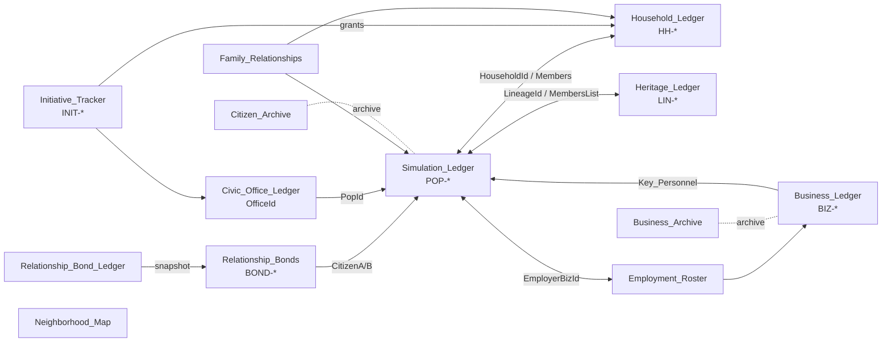
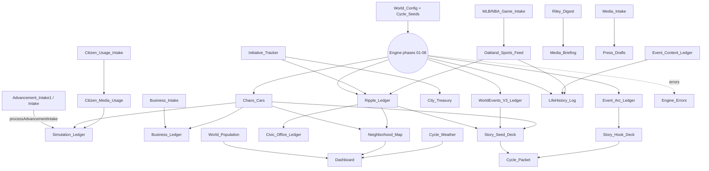

# GODWORLD — Simulation_Narrative Sheet Map

**Sheet:** Simulation_Narrative  
**Sheet ID:** `1-0GNeCzqrDmmOy1wOScryzdRd82syq0Z_wZ7dTH8Bjk`  
**Owner:** pnils08@gmail.com  
**Sheet last modified:** 2026-11-17T03:30:24Z  
**Map generated:** 2026-11-17 (automated weekly run)  
**Tabs read:** 85 (82 with data, 3 empty) · **Current cycle:** 116 (Y3C12, SimYear 3 / Spring)  
**Companion file:** `dependencies.json` (full column lists, 112 dependency edges, 17 issues)

> ⚠️ **Scope change since last run (2026-07-03):** the previous map covered only 6 tabs because the text export was truncated. This run parses the full workbook export (85 tabs). Treat this as a new baseline.

---

## 1. Overview

Simulation_Narrative is the state store for **GODWORLD**, a cycle-based city simulation of Oakland, with Chicago as a secondary city. A rule engine (configured in `World_Config`, audited in `Event_Wiring_Ledger`) runs in numbered phases (phase01–phase08) once per cycle. Each run reads the citizen, business and neighborhood registries and appends to event, ripple and media ledgers. Those ledgers feed a newsroom pipeline (Bay Tribune) that produces story seeds, hooks, briefings and per-cycle packets.

## 2. Environments

| Environment | Tabs | Current state |
|---|---|---|
| **Oakland (primary city)** | 52 | Cycle 116 · sentiment 0.09 · Content · mild · pop 405,992 · employment 95.4% |
| **Chicago (secondary city)** | 3 | sentiment -0.2 · Troubled · cold · feeds stale since ~C94 |
| **Sports universe (A's MLB, Oaks NBA, Bulls)** | 6 | — |
| **Media / Narrative pipeline (Bay Tribune)** | 14 | — |
| **Undocked (sub-game)** | 3 | — |
| **Engine / Ops layer** | 8 | — |

**Citizen ClockModes** (Simulation_Ledger, 1,075 active/retired citizens): `ENGINE` 915, `GAME` 60, `CIVIC` 53, `MEDIA` 47. The previous map's `LIVE` mode no longer exists; engine-driven citizens are now `ENGINE`.

**ID spaces (primary keys):**

| Prefix | Home tab | Distinct IDs | Duplicates |
|---|---|---|---|
| `POP-` | Simulation_Ledger.POPID | 1075 | 0 |
| `BIZ-` | Business_Ledger.BIZ_ID | 283 | 0 |
| `HH-` | Household_Ledger.HouseholdId | 940 | 0 |
| `BOND-` | Relationship_Bonds.BondId | 722 | 0 |
| `INIT-` | Initiative_Tracker.InitiativeID | 14 | 0 |
| `LIN-` | Heritage_Ledger.LineageId | 11 | 0 |
| `CUL-` | Cultural_Ledger.CUL-ID | 55 | 0 |
| `PRG-` | Community_Programs.Program_ID | 33 | 0 |
| `CHI-` | Chicago_Citizens.CitizenId | 124 | 0 |
| `OfficeId` (COUNCIL-/MAYOR-/…) | Civic_Office_Ledger.OfficeId | — | — |
| `ArcId` / `StorylineId` | Event_Arc_Ledger / Storyline_Ledger | 39 arcs / 119 storylines | — |

## 3. Tab Inventory

Status rules: **active** = rows within the last 10 cycles; **stale** = latest row more than 10 cycles old; **legacy/archive** = superseded or archive tab; **empty** = header only.

### Sports (6)

| Tab | Rows | Cols | Cycle range | Status |
|---|---:|---:|---|---|
| `Oakland_Sports_Feed` | 282 | 19 | C30–C116 | 🟢 active |
| `Oaks_Roster` | 13 | 18 | — | 🟢 active |
| `As_Roster` | 95 | 26 | — | 🟢 active |
| `Chicago_Sports_Feed` | 87 | 20 | C40–C91 | 🟡 stale |
| `NBA_Game_Intake` | 41 | 9 | C40–C77 | 🟡 stale |
| `MLB_Game_Intake` | 76 | 9 | C40–C77 | 🟡 stale |

### Media & Narrative (14)

| Tab | Rows | Cols | Cycle range | Status |
|---|---:|---:|---|---|
| `Bay_Tribune_Oakland` | 36 | 6 | — | 🟢 active |
| `Riley_Digest` | 114 | 28 | C1–C116 | 🟢 active |
| `Story_Seed_Deck` | 649 | 18 | C101–C116 | 🟢 active |
| `Media_Briefing` | 34 | 7 | C71–C102 | 🟡 stale |
| `Media_Ledger` | 131 | 25 | C74–C116 | 🟢 active |
| `Story_Hook_Deck` | 2,220 | 14 | C68–C116 | 🟢 active |
| `Press_Drafts` | 164 | 20 | C73–C86 | 🟡 stale |
| `Story_Seed_Deck_v3_legacy` | 1,922 | 20 | C89–C100 | ⚪ legacy/archive |
| `Media_Intake` | 240 | 7 | — | 🟢 active |
| `Citizen_Media_Usage` | 1,348 | 17 | C89–C90 | 🟡 stale |
| `Citizen_Usage_Intake` | 912 | 6 | — | 🟢 active |
| `Cycle_Packet` | 75 | 3 | C38–C116 | 🟢 active |
| `Edition_Coverage_Ratings` | 148 | 7 | C89–C115 | 🟢 active |
| `Story_Seed_Deck_Archive` | 1,558 | 12 | — | ⚪ legacy/archive |

### Civic (4)

| Tab | Rows | Cols | Cycle range | Status |
|---|---:|---:|---|---|
| `Civic_Office_Ledger` | 999 | 21 | — | 🟢 active |
| `Election_Log` | 0 | 14 | — | 🔴 empty |
| `Civic_Sweep_Report` | 9 | 15 | — | 🟢 active |
| `Initiative_Tracker` | 14 | 48 | — | 🟢 active |

### Undocked (sub-game) (3)

| Tab | Rows | Cols | Cycle range | Status |
|---|---:|---:|---|---|
| `Undocked_Standings` | 32 | 12 | — | 🟢 active |
| `Undocked_Feed` | 87 | 13 | C103–C116 | 🟢 active |
| `Undocked_Draw` | 60 | 10 | C108–C117 | 🟢 active |

### Citizens & Households (Oakland) (15)

| Tab | Rows | Cols | Cycle range | Status |
|---|---:|---:|---|---|
| `Simulation_Ledger` | 1,075 | 55 | — | 🟢 active |
| `Reflection_Intake` | 2,844 | 8 | C97–C119 | 🟢 active |
| `Generic_Citizens` | 409 | 15 | — | 🟢 active |
| `Heritage_Ledger` | 11 | 24 | — | 🟢 active |
| `Household_Ledger` | 940 | 16 | — | 🟢 active |
| `Family_Relationships` | 170 | 14 | — | 🟢 active |
| `Relationship_Bond_Ledger` | 7,232 | 19 | C80–C116 | 🟢 active |
| `Relationship_Bonds` | 722 | 17 | — | 🟢 active |
| `LifeHistory_Log` | 28,092 | 7 | C105–C116 | 🟢 active |
| `Youth_Events` | 168 | 11 | C78–C102 | 🟡 stale |
| `Intake` | 11 | 10 | — | 🟢 active |
| `Advancement_Intake1` | 86 | 21 | — | 🟢 active |
| `Citizen_Archive` | 59 | 62 | — | ⚪ legacy/archive |
| `LifeHistory_Archive` | 19,217 | 7 | C0–C104 | ⚪ legacy/archive |
| `Employment_Roster` | 971 | 6 | — | 🟢 active |

### Economy (7)

| Tab | Rows | Cols | Cycle range | Status |
|---|---:|---:|---|---|
| `Business_Ledger` | 283 | 9 | — | 🟢 active |
| `Economic_Parameters` | 315 | 10 | — | 🟢 active |
| `Community_Programs` | 33 | 7 | — | 🟢 active |
| `Casino_Ledger` | 229 | 15 | C106–C116 | 🟢 active |
| `Business_Archive` | 2 | 13 | — | ⚪ legacy/archive |
| `City_Treasury` | 23 | 6 | C110–C116 | 🟢 active |
| `Business_Intake` | 103 | 7 | — | 🟢 active |

### Health & Justice (4)

| Tab | Rows | Cols | Cycle range | Status |
|---|---:|---:|---|---|
| `Hospital_Ledger` | 3 | 16 | — | 🟢 active |
| `Health_Cause_Queue` | 3 | 11 | — | 🟢 active |
| `Judicial_Ledger` | 0 | 21 | — | 🔴 empty |
| `Care_Justice_Census` | 1,512 | 22 | C110–C116 | 🟢 active |

### Event Engines (10)

| Tab | Rows | Cols | Cycle range | Status |
|---|---:|---:|---|---|
| `Storyline_Ledger` | 119 | 12 | — | 🟢 active |
| `WorldEvents_V3_Ledger` | 481 | 7 | C68–C116 | 🟢 active |
| `WorldEvents_Ledger` | 537 | 22 | C19–C116 | ⚪ legacy/archive |
| `Chaos_Cars` | 170 | 12 | C100–C116 | 🟢 active |
| `Ripple_Ledger` | 980 | 13 | C101–C116 | 🟢 active |
| `Texture_Trigger_Log` | 866 | 12 | C43–C116 | 🟢 active |
| `Event_Content_Ledger` | 1,001 | 9 | — | 🟢 active |
| `Event_Arc_Ledger` | 656 | 32 | C69–C114 | 🟢 active |
| `Arc_Ledger` | 37 | 11 | C39–C68 | ⚪ legacy/archive |
| `Domain_Tracker` | 75 | 31 | C40–C116 | 🟢 active |

### City State & Places (12)

| Tab | Rows | Cols | Cycle range | Status |
|---|---:|---:|---|---|
| `Neighborhood_Map` | 22 | 36 | C116–C116 | 🟢 active |
| `Crime_Metrics` | 22 | 13 | — | 🟢 active |
| `Transit_Metrics` | 702 | 9 | C78–C116 | 🟢 active |
| `Neighborhood_Demographics` | 22 | 12 | — | 🟢 active |
| `Cultural_Ledger` | 55 | 20 | — | 🟢 active |
| `World_Population` | 1 | 22 | — | 🟢 active |
| `Simulation_Calendar` | 1 | 6 | — | 🟢 active |
| `Cycle_Weather` | 41 | 11 | C76–C116 | 🟢 active |
| `Faith_Organizations` | 16 | 10 | — | 🟢 active |
| `Faith_Ledger` | 250 | 9 | C78–C116 | 🟢 active |
| `Sports_Calendar` | 12 | 3 | — | 🟢 active |
| `World_Drift_Report` | 3 | 22 | — | 🟢 active |

### Engine & Ops (8)

| Tab | Rows | Cols | Cycle range | Status |
|---|---:|---:|---|---|
| `Dashboard` | 29 | 0 | — | 🟢 active |
| `Cycle_Seeds` | 39 | 8 | C78–C116 | 🟢 active |
| `Content_Telemetry` | 14 | 8 | C103–C116 | 🟢 active |
| `World_Config` | 251 | 3 | — | 🟢 active |
| `Carry_Forward_Store` | 30 | 4 | C114–C116 | 🟢 active |
| `Engine_Errors` | 9 | 10 | C108–C116 | 🟢 active |
| `Event_Wiring_Ledger` | 39 | 11 | — | 🟢 active |
| `_CycleCheckpoint` | 0 | 0 | — | 🔴 empty |

### Chicago (2)

| Tab | Rows | Cols | Cycle range | Status |
|---|---:|---:|---|---|
| `Chicago_Feed` | 59 | 22 | C1–C94 | 🟡 stale |
| `Chicago_Citizens` | 124 | 10 | — | 🟢 active |

## 4. Dependency Graph

### 4.1 Core entity graph (key references)

### 4.2 Per-cycle engine flow

### 4.3 Reference integrity (cross-tab key scan)

| Referencing tab | → Home | Key | Distinct refs | Unresolved (live) | Unresolved (incl. archive) |
|---|---|---|---:|---:|---:|
| Story_Seed_Deck | Business_Ledger | `BIZ-*` | 230 | 3 | 1 ⚠️ |
| Simulation_Ledger | Business_Ledger | `BIZ-*` | 87 | 0 | 0 |
| Employment_Roster | Business_Ledger | `BIZ-*` | 83 | 0 | 0 |
| Ripple_Ledger | Business_Ledger | `BIZ-*` | 50 | 1 | 0 |
| Chaos_Cars | Business_Ledger | `BIZ-*` | 46 | 2 | 2 ⚠️ |
| Carry_Forward_Store | Business_Ledger | `BIZ-*` | 27 | 0 | 0 |
| Undocked_Draw | Business_Ledger | `BIZ-*` | 21 | 0 | 0 |
| Riley_Digest | Business_Ledger | `BIZ-*` | 19 | 0 | 0 |
| LifeHistory_Log | Business_Ledger | `BIZ-*` | 16 | 0 | 0 |
| Generic_Citizens | Business_Ledger | `BIZ-*` | 5 | 0 | 0 |
| Citizen_Archive | Business_Ledger | `BIZ-*` | 5 | 0 | 0 |
| Initiative_Tracker | Business_Ledger | `BIZ-*` | 5 | 0 | 0 |
| Heritage_Ledger | Business_Ledger | `BIZ-*` | 4 | 0 | 0 |
| Business_Archive | Business_Ledger | `BIZ-*` | 4 | 2 | 0 |
| LifeHistory_Archive | Business_Ledger | `BIZ-*` | 4 | 0 | 0 |
| Business_Intake | Business_Ledger | `BIZ-*` | 1 | 0 | 0 |
| Simulation_Ledger | Heritage_Ledger | `LIN-*` | 11 | 0 | 0 |
| Simulation_Ledger | Household_Ledger | `HH-####-###` | 685 | 0 | 0 |
| Family_Relationships | Household_Ledger | `HH-####-###` | 169 | 0 | 0 |
| Casino_Ledger | Household_Ledger | `HH-####-###` | 154 | 0 | 0 |
| Citizen_Archive | Household_Ledger | `HH-####-###` | 9 | 0 | 0 |
| Carry_Forward_Store | Initiative_Tracker | `INIT-*` | 14 | 0 | 0 |
| Storyline_Ledger | Initiative_Tracker | `INIT-*` | 13 | 0 | 0 |
| City_Treasury | Initiative_Tracker | `INIT-*` | 4 | 0 | 0 |
| Press_Drafts | Initiative_Tracker | `INIT-*` | 2 | 0 | 0 |
| Media_Intake | Initiative_Tracker | `INIT-*` | 2 | 0 | 0 |
| Civic_Office_Ledger | Initiative_Tracker | `INIT-*` | 1 | 0 | 0 |
| Household_Ledger | Initiative_Tracker | `INIT-*` | 1 | 0 | 0 |
| LifeHistory_Log | Initiative_Tracker | `INIT-*` | 1 | 0 | 0 |
| Story_Seed_Deck_v3_legacy | Initiative_Tracker | `INIT-*` | 1 | 0 | 0 |
| Relationship_Bond_Ledger | Relationship_Bonds | `BOND-*` | 2,942 | 2418 | 2418 ⚠️ |
| LifeHistory_Log | Simulation_Ledger | `POP-*` | 1,077 | 6 | 0 |
| Employment_Roster | Simulation_Ledger | `POP-*` | 971 | 3 | 0 |
| LifeHistory_Archive | Simulation_Ledger | `POP-*` | 968 | 76 | 19 ⚠️ |
| Relationship_Bond_Ledger | Simulation_Ledger | `POP-*` | 941 | 59 | 2 ⚠️ |
| Story_Seed_Deck | Simulation_Ledger | `POP-*` | 919 | 7 | 0 |
| Household_Ledger | Simulation_Ledger | `POP-*` | 890 | 9 | 1 ⚠️ |
| Relationship_Bonds | Simulation_Ledger | `POP-*` | 706 | 2 | 0 |
| Reflection_Intake | Simulation_Ledger | `POP-*` | 522 | 3 | 0 |
| Ripple_Ledger | Simulation_Ledger | `POP-*` | 332 | 3 | 0 |
| Family_Relationships | Simulation_Ledger | `POP-*` | 242 | 2 | 0 |
| Casino_Ledger | Simulation_Ledger | `POP-*` | 241 | 0 | 0 |
| Storyline_Ledger | Simulation_Ledger | `POP-*` | 150 | 1 | 0 |
| Media_Briefing | Simulation_Ledger | `POP-*` | 104 | 9 | 2 ⚠️ |
| Cycle_Packet | Simulation_Ledger | `POP-*` | 104 | 9 | 2 ⚠️ |
| Citizen_Usage_Intake | Simulation_Ledger | `POP-*` | 98 | 5 | 1 ⚠️ |
| As_Roster | Simulation_Ledger | `POP-*` | 95 | 44 | 0 |
| Citizen_Archive | Simulation_Ledger | `POP-*` | 59 | 59 | 0 |
| Undocked_Draw | Simulation_Ledger | `POP-*` | 55 | 0 | 0 |
| Cultural_Ledger | Simulation_Ledger | `POP-*` | 55 | 0 | 0 |
| Youth_Events | Simulation_Ledger | `POP-*` | 55 | 0 | 0 |
| Chaos_Cars | Simulation_Ledger | `POP-*` | 40 | 0 | 0 |
| Civic_Office_Ledger | Simulation_Ledger | `POP-*` | 39 | 0 | 0 |
| Citizen_Media_Usage | Simulation_Ledger | `POP-*` | 37 | 3 | 1 ⚠️ |
| Bay_Tribune_Oakland | Simulation_Ledger | `POP-*` | 36 | 0 | 0 |
| Business_Ledger | Simulation_Ledger | `POP-*` | 36 | 0 | 0 |
| Faith_Organizations | Simulation_Ledger | `POP-*` | 33 | 0 | 0 |
| Undocked_Standings | Simulation_Ledger | `POP-*` | 32 | 0 | 0 |
| Undocked_Feed | Simulation_Ledger | `POP-*` | 32 | 0 | 0 |
| Generic_Citizens | Simulation_Ledger | `POP-*` | 28 | 0 | 0 |
| Heritage_Ledger | Simulation_Ledger | `POP-*` | 20 | 0 | 0 |
| Oaks_Roster | Simulation_Ledger | `POP-*` | 10 | 1 | 0 |
| Community_Programs | Simulation_Ledger | `POP-*` | 9 | 1 | 1 ⚠️ |
| Story_Seed_Deck_v3_legacy | Simulation_Ledger | `POP-*` | 4 | 0 | 0 |
| City_Treasury | Simulation_Ledger | `POP-*` | 4 | 0 | 0 |
| Hospital_Ledger | Simulation_Ledger | `POP-*` | 3 | 0 | 0 |
| Health_Cause_Queue | Simulation_Ledger | `POP-*` | 3 | 0 | 0 |
| Intake | Simulation_Ledger | `POP-*` | 2 | 0 | 0 |
| Oakland_Sports_Feed | Simulation_Ledger | `POP-*` | 1 | 0 | 0 |
| Engine_Errors | Simulation_Ledger | `POP-*` | 1 | 0 | 0 |

"Unresolved (live)" mostly means archived citizens or businesses, which is expected. Only the last column is a true dangling reference.

### 4.4 Circular / bidirectional links

| Cycle | Linked via | State |
|---|---|---|
| Simulation_Ledger ⇄ Household_Ledger | SL.HouseholdId ⇄ Household_Ledger.Members/HeadOfHousehold | in sync (781/781) |
| Simulation_Ledger ⇄ Business_Ledger ⇄ Employment_Roster | SL.EmployerBizId ⇄ Employment_Roster ⇄ Business_Ledger.Key_Personnel | DRIFT: 23 employed citizens missing from roster, 10 with different BIZ |
| Simulation_Ledger ⇄ Heritage_Ledger | SL.LineageId ⇄ Heritage_Ledger.MembersList | in sync |
| Ripple_Ledger ⇄ Neighborhood_Map ⇄ Story_Seed_Deck | ripples change hood metrics → seeds/arcs → new ripples | by design (feedback loop) |
| Relationship_Bonds ⇄ Relationship_Bond_Ledger | snapshot ⇄ history | DRIFT: 2,424 bond IDs in history not in snapshot |

No harmful write cycles were found. The loops above are either two-way stored links (which must be kept in sync) or the intended ripple→seed→ripple feedback loop.

## 5. Issues Flagged

| ID | Severity | Scope | Type | Description |
|---|---|---|---|---|
| ISS-001 | 🔴 HIGH | Election_Log | missing_data | Election_Log is now empty (header only). The 2026-07-03 run recorded 5 Cycle 97 council results. Either the data was cleared or it moved to Civic_Office_Ledger (LastElection/NextElection). Confirm and document. |
| ISS-002 | 🔴 HIGH | Event_Arc_Ledger | stuck_state | 39 distinct arcs; 37 unresolved (36 stuck at "peak", last touched before C110). The Event_Wiring_Ledger cap is "max 10 active arcs". Arcs are not resolving or decaying. |
| ISS-003 | 🔴 HIGH | Dashboard | missing_link | Dashboard Civic panel shows "--" while Initiative_Tracker has 6 passed / 7 failed / 1 proposed. The Bonds panel shows "--"/0 with 689 active bonds. The Sports/Season/Holiday cells are also "--". These panels are not wired to their source tabs (carried over from last run). |
| ISS-004 | 🔴 HIGH | Engine_Errors | unresolved_errors | 9 unresolved engine errors. 4× Phase1-FireGuard "engine.275: Cycle 116 was already admitted" on 2026-11-15/16 (repeated re-admission attempts). 3 duplicate WeekRecord rejections (C109). 1 WeekRecord without a game-result (C108). 1 wd-cards-daemon timeout for POP-00903. |
| ISS-005 | 🟡 MED | Relationship_Bond_Ledger→Relationship_Bonds | sync_drift | The history ledger contains 3,099 distinct BondIds, but the snapshot holds 722. 2,413 missing bonds are "active" by their latest history row (none touched since C114). Either the snapshot prunes silently or bonds are being lost. |
| ISS-006 | 🟡 MED | Simulation_Ledger↔Employment_Roster | circular_sync_drift | The employer link is stored in 3 places. 23 citizens with an EmployerBizId are absent from Employment_Roster; 10 point to a different BIZ. The roster also has 41 "unmatched" and 70 "UNTRACKED" rows. |
| ISS-007 | 🟡 MED | Neighborhood (cross-tab) | environment_mismatch | Neighborhood_Map defines 22 canonical neighborhoods. Montclair (≈70 rows across Faith_Ledger, WorldEvents_V3, Household, Youth, Story decks), Old Oakland, Brooklyn Basin, Elmhurst, Jingletown and Coliseum are used but not in the map. Aliases are also used: "Piedmont Avenue" vs "Piedmont Ave", and "Citywide/CITYWIDE/city-wide/City-wide". Directional codes (NORTH/CENTRAL…) and districts (D1–D9) are used as neighborhoods in Ripple_Ledger, Texture_Trigger_Log and Story_Seed_Deck. Chicago neighborhoods leak into Oakland tabs (Lincoln Park, United Center Area, Near North Side). |
| ISS-008 | 🟡 MED | Reflection_Intake | future_dated | 12 rows have Cycle 117–119, but World_Config.cycleCount=116. |
| ISS-009 | 🟡 MED | POPID references | dangling_reference | POP-00751/POP-00752 are referenced in Household_Ledger, Relationship_Bond_Ledger, Media_Briefing and Cycle_Packet but exist in neither Simulation_Ledger nor Citizen_Archive. POP-00412 (Community_Programs founder) is missing too. LifeHistory_Archive has 19 unresolvable POPIDs. |
| ISS-010 | 🟡 MED | BIZ references | dangling_reference | BIZ-00067 and BIZ-00069 are targeted by Chaos_Cars (BIZ-00069 also by Story_Seed_Deck) but exist in neither Business_Ledger nor Business_Archive. |
| ISS-011 | 🟡 MED | Event_Wiring_Ledger | self_reported_gaps | The engine audit itself flags several gaps. textureTriggers: "No consumer found". citizenContextBuilder: zero production callers. buildEveningFood: foodTrend carry-forward has no consumer. buildEveningFamous: famousNames carry-forward is dead. eventArcEngine: involvedCitizens never populated. faithEventsEngine: never attaches POPIDs. householdFormationEngine: divorce not implemented. applyGameNightMoments writes LifeHistory_Log directly (exception status unverified). |
| ISS-012 | 🟢 LOW | Legacy tabs | deprecated_pattern | Superseded tabs are still present and some are still written: Story_Seed_Deck_v3_legacy (last C100), Arc_Ledger (last C68, superseded by Event_Arc_Ledger), WorldEvents_Ledger alongside WorldEvents_V3_Ledger (both written through C116 = double write). |
| ISS-013 | 🟢 LOW | Stale feeds | stale_data | Tabs with no rows in the last 10+ cycles: MLB_Game_Intake / NBA_Game_Intake (C77), Press_Drafts (C86), Citizen_Media_Usage (C90), Chicago_Sports_Feed (C91), Chicago_Feed (C94), Media_Briefing / Youth_Events (C102). The Chicago environment looks frozen since ~C94. |
| ISS-014 | 🟢 LOW | Empty tabs | undocumented_entry | Judicial_Ledger (header only), _CycleCheckpoint (fully empty), Election_Log (see HIGH). |
| ISS-015 | 🟢 LOW | Simulation_Ledger.SpouseId | format_inconsistency | 38 SpouseId values embed the name ("POP-00002 Amara Keane") instead of a bare POPID, which breaks exact-match joins. |
| ISS-016 | 🟢 LOW | Placeholder data | undocumented_entry | The literal "POP-ID" placeholder appears in Citizen_Media_Usage and Citizen_Usage_Intake. Sports_Calendar has a typo, "off-seaon" (×3). |
| ISS-017 | 🟢 LOW | As_Roster | missing_link | 44 of 95 roster POPIDs exist only in Citizen_Archive (retired/traded players still listed). Oaks_Roster has 1 such entry. |

## 6. Changes Since Last Run (2026-07-03, Cycle 100)

- **Coverage:** 6 → 85 tabs read. The previous run used a truncated text export.
- **Cycle:** 100 → 116. Population 385,162 → 405,992. Oakland sentiment 0.8 → 0.09 (Thriving → Content).
- **Owner** changed: riley.steward.system@gmail.com → pnils08@gmail.com.
- **Resolved:** ISS-008 (prev): Business registry now exists (Business_Ledger, 283 BIZ IDs); ISS-002 (prev): Narrative_Bridge tab no longer exists; narrative now flows through Story_Seed_Deck/Story_Hook_Deck/Cycle_Packet; ISS-003 (prev): Advancement_Intake1 now has 86 rows; ISS-001 (prev): Dashboard now reflects Cycle 116 (header values current).
- **Regressed:** Election_Log went from 5 rows (C97) to empty.
- **Still open:** Dashboard Civic/Bonds/Sports panels remain unwired.

---

*Map auto-generated by the weekly mapping agent. Do not edit manually; changes will be overwritten on the next run.*
